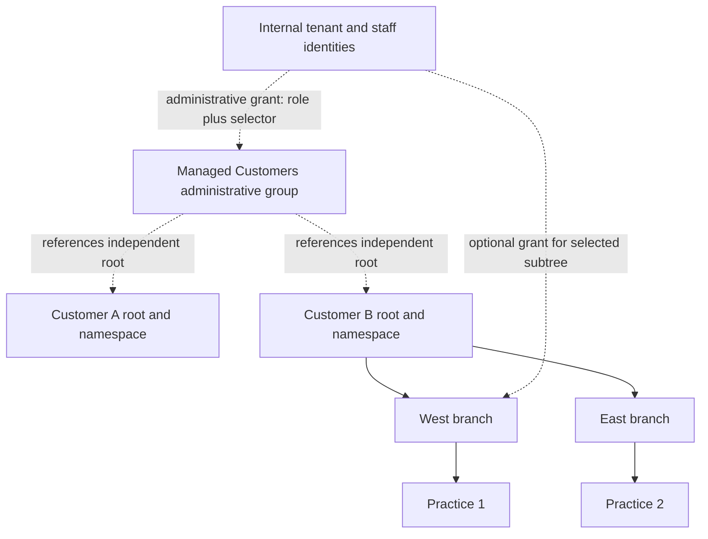

# Tenant identities, customer hierarchy and delegated administration

**Status:** Proposed design for independent technical and human review.
**Revision:** 0.2, 2026-10-10 (delivery order, latency constraints and prerequisite defects added).
**Owner:** OutLabsAuth maintainers; consuming products own their domain policy and migration acceptance.
**Decision record:** proposed DD-062; no acceptance is implied by this document or existing experimental code.
**Working branch:** `codex/tenant-auth-design-20261010`.

This is the canonical design proposal in the OutLabsAuth repository. It expands
the earlier experimental contract. It describes proposed capabilities, rationale,
alternatives, consequences, review decisions and implementation gates. It is not
an installation guide or a claim that the proposed capabilities already exist.
Public examples are synthetic and consumer agnostic. Product-specific names,
source records, production topology and deployment instructions belong to their
private owners, not this repository.

No new runtime implementation, schema change, publication or deployment is
requested by this planning revision. Preserve the existing experimental evaluator
as a prototype until this proposal's open decisions are resolved. Do not infer
approval of a data migration from approval of the library design.

## Contents and review routes

1. [Outcome and proposed direction](#1-outcome-and-proposed-direction)
2. [Terminology and ownership](#2-terminology-and-ownership)
3. [Verified baseline and prototype limits](#3-verified-baseline-and-prototype-limits)
4. [Requirements and invariants](#4-requirements-and-invariants)
5. [Use cases and consequences](#5-use-cases-and-consequences)
6. [Alternatives and topology decision](#6-alternatives-and-topology-decision)
7. [Proposed persistent model](#7-proposed-persistent-model)
8. [Identity resolution and authentication flows](#8-identity-resolution-and-authentication-flows)
9. [Administrative authorization](#9-administrative-authorization)
10. [Delegation and authority expansion](#10-delegation-and-authority-expansion)
11. [Route, query and host contracts](#11-route-query-and-host-contracts)
12. [Transactions, concurrency and caches](#12-transactions-concurrency-and-caches)
13. [Audit, deletion and frozen historical evidence](#13-audit-deletion-and-frozen-historical-evidence)
14. [Repeatable external-source reconciliation](#14-repeatable-external-source-reconciliation)
15. [Schema upgrade and compatibility](#15-schema-upgrade-and-compatibility)
16. [Client, CLI and operator experience](#16-client-cli-and-operator-experience)
17. [Threat model and abuse cases](#17-threat-model-and-abuse-cases)
18. [Acceptance, performance and operational evidence](#18-acceptance-performance-and-operational-evidence)
19. [Delivery order, work packages and gates](#19-delivery-order-work-packages-and-gates)
20. [Release, rollout and recovery](#20-release-rollout-and-recovery)
21. [Consequences, unresolved decisions and review process](#21-consequences-unresolved-decisions-and-review-process)
22. [Source references and status ledger](#22-source-references-and-status-ledger)

**Delivery order in one paragraph (revision 0.2, section 19):** decide and
measure first; fix eight existing baseline defects in cache invalidation, account
restore, OAuth enrollment and conditioned caching (section 12.3); ship
administrative grants over today's identities, disabled by default, before any
identity-namespace work; pull the same-transaction lifecycle observer forward so
hosts can build history and replay in parallel; add namespaces in legacy mode as a
proven no-op; then offer qualified identity to new installations only. Converting
an already populated legacy installation is a later, optional stage. Under this
order the one irreversible step, admitting duplicate identifiers, never happens
on an existing legacy installation unless that deployment separately opts in.
Section 21.4 records how revision 0.2 disposes of the nine findings from the
independent review of revision 0.1.

Product reviewers should start with sections 1, 2, 5, 6, 16 and 21. Identity
reviewers should focus on 7, 8, 13 and 15. Authorization reviewers should focus on
9–12 and 17. Migration/operations reviewers should focus on 12–15 and 18–20.
Every reviewer should inspect the invariants, the decision register and the
section 19 delivery order. The companion
[review packet](./TENANT_AUTH_REVIEW_PACKET.md) provides structured review prompts.

### Start here (for whoever implements this)

**Latest implementation state on 2026-10-11:** S1 implements all eight baseline
corrections, two nullable security-state columns, bounded migration/index checks,
and recovery fencing. Independent publication review closed eight additional
reproduced gaps; all three reviewers are green. The
[public a37 release receipt](S1_RELEASE_A37.md) owns
accepted source, exact artifact and public-release evidence. Review boundaries are
in [S1_REVIEW_A37.md](S1_REVIEW_A37.md). Consumer adoption, certified release train,
staging and external restore admission are separate gates. Local proof does not
establish a production RPO/RTO or S3 anti-rewind runner. An isolated, unreleased
`0.1.0a38` foundation adds persistent S2 policy and optional S3 lifecycle
observation; [current scope and remaining gates](S2_S3_FOUNDATION_2026-10-11.md)
are explicit. The explicit S2 credential/target/account/list facade and focused concurrency
are [locally qualified](S2_KEY_LIFECYCLE_ACCEPTANCE_2026-10-11.md); existing
mounted IAM authorization remains unadopted. S3 is opt-in and
unadopted by public consumers. Namespace stages remain unimplemented. S1 delivery
does not adopt proposed DD-062 or resolve the remaining S0 decisions.

**Earlier planning checkpoint on 2026-10-10:** design revision 0.2 plus a completed independent review
(nine findings, all reconciled in section 21.4). Nothing is implemented, no decision
in section 21.2 is accepted, and no stage is scheduled. The unwired evaluator
prototype (`outlabs_auth/services/administrative_scope.py`, 51 tests) is the only
code, and it must stay unwired until stage S2.

**Read in this order:** the delivery paragraph above; section 19 (stages S0–S7 and
their exits); section 12.3 (the S1 baseline defects); section 21.4 (review
dispositions); section 21.2 (decisions to record); then the
[independent review](./TENANT_AUTH_INDEPENDENT_REVIEW_2026-10-10.md) and its lane
reports and synthetic reproductions in `docs/reviews/tenant-auth-2026-10-10/`.
Sections 7–18 are the detailed contract to consult per stage, not a reading list.

**First work when this is picked up:**

1. **S0:** record maintainer dispositions for the S0 decisions in
   [DESIGN_DECISIONS.md](./DESIGN_DECISIONS.md) as DD-062, and the numeric budgets
   for section 18.4. Consumers record their private inventories.
2. **S1 (one security patch):** qualify the implemented B1–B3, TI-01–TI-04 and
   F-admin-01 corrections together. Review the local migration/recovery, numeric
   budget and installed-artifact receipts, then qualify the exact new-version
   release artifacts and consumer rollout. The epoch and historical
   protection columns follow section 15.6; the original one-column estimate is
   superseded by the two-column correction in the receipt. Keep warm-path query
   budgets unchanged.
3. Then S2 and S3 in parallel, and S4 when a consumer needs it.

**A consumer does not need every stage.** One whose population has no identifier
shared across unrelated customers can adopt S1–S3 and defer S4–S5. It keeps global
uniqueness and surfaces any first collision as a conflict, never a merge; that
collision is the trigger to schedule S4–S5.

**Working rules:** this repository is public and stays consumer-agnostic (no
product names, private topology or private paths). Qualify locally with real
PostgreSQL and Redis (`TEST_REDIS_REQUIRED=1`, then the full suite); hosted
workflows are for publishing only. A stage is published only through the normal
tagged release, and each consumer adopts it under its own staging acceptance.

## 1. Outcome and proposed direction

A deployment must support independent customer accounts, corporate customer trees
and internal staff administration without confusing account ownership, business
hierarchy and administrative reach. One natural person may use the same email in
two unrelated customers while holding separate local identities. Within one
customer, the identity can belong to several offices or practices. Internal staff
can receive different roles for one practice, a corporate subtree or all managed
customers, without becoming those customers' ordinary members.

The recommended first release adds a stable identity namespace, preserves
independent customer roots and introduces administrative groups/grants separate
from the entity tree. It keeps existing global-email deployments in an explicit
legacy namespace. Tenant-qualified behavior is opt-in only after the entire
identity and authorization contract is qualified; a partial opt-in is unsafe.

A literal structural parent above unrelated customer roots is considered below.
It is not implemented by setting their `parent_id` to a portfolio entity. That
would change today's highest-ancestor ownership rules. If reviewers require a
real shared parent in the first release, the implementation scope must instead
include an explicit tenant-boundary model throughout the library before moving
any populated roots. Display grouping is the smaller recommended first step.

The proposed separation is:

| Concern | Answers | Proposed authority |
| --- | --- | --- |
| Identity namespace | Which local account does this identifier select? | Immutable namespace ID plus identifier; user UUID after authentication |
| Owning customer | Who owns account lifecycle and customer-wide credentials? | Protected owning customer root in phase one, mapped to the namespace |
| Entity hierarchy | Which business units are parent/child? | Existing structural entities and closure, bounded by the owning customer |
| Ordinary membership | What can a customer account do at a unit? | Membership/role permissions evaluated at that target |
| Administrative grant | What can a staff principal do across customer boundaries? | One live grant binding a role and a target selector |
| Frontend profile | Which application issued/accepts the session and routes delivery? | Registered frontend profile and `azp`; never a tenant selector by itself |
| Platform authority | Who changes global policy or manages protected operators? | Explicit separate platform authority, not an all-customer grant |

**Reasoning:** email is a mutable delivery identifier; a structural ancestor is a
mutable organization relationship; an administrative portfolio may span multiple
customers. Treating any one as all three makes reorganizations, invitations,
recovery and delegation transfer authority accidentally. Separate contracts cost
more implementation, but allow each operation to establish the exact authority
it needs and make future topology changes reviewable.

## 2. Terminology and ownership

### 2.1 Definitions

- **Deployment:** one embedded Auth installation and its schema/configuration.
  Identifiers in another deployment are not automatically shared accounts.
- **Person:** an external human concept. No new global person/master-account model
  is proposed. Cross-customer person matching is outside ordinary Auth authority.
- **User identity:** one local `User.id`, credentials, lifecycle, challenges,
  sessions and personal API keys. It belongs to one identity namespace.
- **Identity namespace:** a stable, non-null lookup boundary. Customer-scoped
  namespaces reserve identifiers independently. An explicit default namespace
  preserves the current global-email lookup contract for legacy consumers.
- **Customer tenant:** the owner of a set of business units and customer accounts.
  The first release keeps it anchored at a parentless structural root. A namespace
  for a scoped customer maps to this protected root; they are not interchangeable
  IDs and changing a display tree does not move a namespace.
- **Internal tenant:** a deployment-designated trusted operator organization.
  Authority to mark it trusted is platform-owned, not an editable company type,
  email suffix, display name or request flag.
- **Practice/office/team:** an operational entity in a customer. Membership gives
  association and scoped roles; it does not prove legal ownership or licensing.
- **Account owner:** a host business relationship. A role named owner and being
  first in a source list do not establish that relationship.
- **Administrative group:** an Auth-owned collection of independent customer
  roots for staff targeting. It is not an `EntityClass.ACCESS_GROUP`, a structural
  parent, an ordinary membership, a tenant or an identity namespace.
- **Administrative role template:** a protected reusable permission policy usable
  only through administrative grants. Its storage representation remains a review
  decision; it must never silently become a direct system-wide user role.
- **Administrative grant:** a principal/template/target binding, with status,
  validity, provenance and audit. It may authorize a concrete action at a concrete
  customer target; it does not turn the holder into `is_global`.
- **Platform operator:** a separately authorized principal for system definitions,
  bootstrap, trusted-root policy, protected accounts and exceptional recovery.
- **Reconciliation:** a reviewed replay of source-owned contributions, preserving
  independent target-owned state. It is not unconditional overwrite or import.

### 2.2 Boundary between the library and consuming products

Auth owns credential identity, identifier uniqueness, authentication flows,
entity/membership authorization, administrative grants, service principals,
policy validation, permission queries, revocation and generic transactional audit.
It must expose supported typed service/query boundaries so hosts do not re-create
security policy with direct joins into Auth tables.

The host owns business account ownership, notification preferences/eligibility,
source snapshots/crosswalks, product history/search semantics, licensing, billing,
business resource-to-entity mapping and external-source reconciliation policy.
Auth can support a transaction/outbox interface; it must not know private source
collection names, business-specific removal events or customer migration cohorts.

Frontend clients own interaction and navigation. Their role menus, selected
practice, hidden buttons and root-type lists are presentation. The server resolves
identity and checks authority on every operation. Selection is not permission.

## 3. Verified baseline and prototype limits

### 3.1 Runtime facts, not proposed behavior

Baseline: published `0.1.0a36`, tag source
`7ec9acf77f37ead0d7eb50347334224cc9d72e87`. The experimental branch starts from
`3c8be781`, whose additional change is maintainer backlog documentation. Source
links below refer to this repository; no production deployment is inferred.

| Current behavior | Source | Design implication |
| --- | --- | --- |
| `User.email` is globally unique | [user model](../outlabs_auth/models/sql/user.py) | Same email cannot represent two independent customer identities |
| `root_entity_id` is nullable, entity-FK with `SET NULL` | Same model | Root is unsuitable as the only immutable credential namespace |
| Create/invite/login/recovery use global email lookup | [UserService](../outlabs_auth/services/user.py), [AuthService](../outlabs_auth/services/auth.py), [auth router](../outlabs_auth/routers/auth.py) | Changing only uniqueness leaves wrong-account or ambiguous flows |
| Membership adoption binds to highest root; cross-root membership is rejected | [MembershipService](../outlabs_auth/services/membership.py) | Staff cannot use ordinary memberships for restricted cross-customer administration |
| Scope expands owning root and memberships to descendants | [AccessScopeService](../outlabs_auth/services/access_scope.py) | Namespace ownership alone does not provide practice-limited visibility |
| Active direct system-wide role produces global scope | Same service; DD-056 | Action permissions can differ, but reach includes every tree |
| Direct scoped roles/own-tenant guards prevent foreign-root grants and writes | [RoleService](../outlabs_auth/services/role.py), [scope guards](../outlabs_auth/routers/_scope.py), DD-061 | Administrative grants need explicit new operation-specific handling |
| Populated root-changing moves are refused | [EntityService](../outlabs_auth/services/entity.py), DD-061 | A parent change is not a safe tenant migration shortcut |
| Social identity uniqueness is global `(provider, provider_user_id)` | [social model](../outlabs_auth/models/sql/social_account.py), [OAuth router](../outlabs_auth/routers/oauth.py) | Provider account reuse across local namespaces requires a deliberate change |
| Tokens identify `sub`; sessions also bind `azp` | [JWT utilities](../outlabs_auth/utils/jwt.py), [refresh model](../outlabs_auth/models/sql/token.py) | A namespace must be explicitly bound on every relevant issuance/verification path |
| Challenges bind user/profile, OTP verification still looks up email/phone | [challenge model](../outlabs_auth/models/sql/auth_challenge.py), AuthService | Short-code flows cannot rely on global identifier lookup after duplicates exist |
| User deletion retains the account and revokes memberships, direct roles, refresh rows and keys. **Corrected in revision 0.2:** restore re-activates a retained `is_superuser` flag and unexpired pre-deletion access JWTs, and profile editing can change a deleted account's email and release its reservation (review findings TI-01, TI-02, TI-04) | UserService, [implementation status](./CURRENT_IMPLEMENTATION_STATUS.md), [independent review](./TENANT_AUTH_INDEPENDENT_REVIEW_2026-10-10.md) | Restore is not yet identity-only; section 12.3 corrects the baseline before each namespace inherits it |
| OAuth association state binds user/profile/browser but the callback does not recheck account status or credential security changes before committing a new provider link (TI-03) | [OAuth associate router](../outlabs_auth/routers/oauth_associate.py), [OAuth state store](../outlabs_auth/routers/oauth_state_store.py) | Method enrollment needs a cancellation rule, not only exact-account binding |
| With ABAC enabled, the permission-check cache key omits the current time that the policy engine generates for evaluation (F-admin-01) | [permission service](../outlabs_auth/services/permission.py), [policy engine](../outlabs_auth/services/policy_engine.py) | Conditioned decisions cannot be cached on the existing key |
| Frontend profiles are audience/routing context | [frontend types](../outlabs_auth/frontend/types.py), DD-059 | `app`, `azp` and customer namespace are different axes |
| Historical legacy `tenant_id` columns were deliberately removed | [revision 0002](../outlabs_auth/migrations/versions/20260317_0002_reconcile_legacy_bootstrap_schema.py) | Do not resurrect their old values or assume their semantics match this proposal |
| Declarative CLI resolves email references and HTTP apply may be partial | [declarative code](../outlabs_auth/cli_support/declarative.py) | Namespace-aware references and a versioned plan contract are required |

The authoritative existing design decisions are DD-002, DD-050–056 and DD-059–061
in [DESIGN_DECISIONS.md](./DESIGN_DECISIONS.md). DD-061 deliberately keeps listings
per owning root and flat permission unions. This proposal changes selected
semantics through a reviewed opt-in contract; it must not claim those earlier
choices were already practice-scoped or tenant-qualified.

### 3.2 What the existing experiment proves

Candidate `e188f3a`, with boundary additions `a03692c`, provides
[administrative_scope.py](../outlabs_auth/services/administrative_scope.py). It is
side-effect-free and unwired. Its 51 tests establish one-grant action/target
matching, exact/subtree/group selectors, trusted Internal actor, Internal
exclusion, grant/role validity, account-root targeting, API-key intersection and
condition outcomes bound to actor/grant/role/entity/action.

It trusts callers to supply current validated policy/topology maps and evaluated
conditions. It supplies no persistence, registration, delegation, atomic
management, route guards, SQL filtering, cache invalidation or login namespace.
Passing these tests does not prove complete application authorization. Treat its
names/types as provisional: reviewers can replace them without compatibility
promises to released consumers.

Prior local verification covered 1,306 existing Auth tests with three optional
Twilio/SendGrid skips, plus 51 new policy tests; 17 real-Redis contracts ran
independently and repeat existing cases. These are baseline/foundation evidence,
not acceptance of this full proposal. New persistence and flows need new tests.

## 4. Requirements and invariants

The required product outcomes are separate customer identities, same-customer
practice membership, complete current-participant provisioning and configurable
Internal administration. The remaining invariants express proposed safety and
compatibility obligations derived from those outcomes and the inspected baseline.
Detailed schema/API choices and these proposed enforcement contracts still require
review; this table does not record maintainer acceptance.

| ID | Requirement/invariant | Why it exists |
| --- | --- | --- |
| R01 | Separate identity per unrelated customer, even with the same email | Independent credentials, suspension, recovery and customer ownership |
| R02 | One identity may participate in several units of the same customer | Corporate teams should not need one account per office |
| R03 | Every contact accepted as a current login/member migrates completely or is a surfaced conflict | Silent merge, skip or invented email aliases falsify completeness |
| R04 | Internal staff may administer selected practices, subtrees or all managed customers through configurable roles | Different staff jobs need different actions and reach |
| R05 | Customer accounts cannot inherit Internal/platform authority from email, root name or client claims | Separate same-email identities must not become staff |
| R06 | Identity namespace is non-null, stable and reserved through retained deletion | Mutable hierarchy and nullable roots cannot define credentials |
| R07 | Resolve namespace before identifier; never choose a different namespace because it matches | Prevent recovery/login/provisioning account substitution |
| R08 | Session/challenge/OAuth state binds concrete account, namespace and application context | No late callback or renewal switches accounts |
| R09 | Account ownership differs from member visibility and business ownership | A branch roster cannot grant control of corporate credentials |
| R10 | Each allow joins action and target within a qualifying live authority source | No read-A/update-B permission stitching |
| R11 | Ordinary membership cannot cross owning customer boundaries | Staff delegation does not become customer membership |
| R12 | All-customer administration excludes Internal and platform objects | Customer management is not platform administration |
| R13 | Definition, grant, account, namespace and relevant target lifecycle all apply | Revoked/dormant policy cannot authorize |
| R14 | Missing/invalid authority or topology fails closed | Scope resolution failures cannot become unrestricted access |
| R15 | Identifier changes invalidate destination-bound flows | Old email/phone links cannot verify new identifiers |
| R16 | API-key authority is intersected with owner/grant/target scope | A privileged owner cannot broaden an anchored key |
| R17 | List filtering and pagination use action-specific authorized SQL scope | No post-pagination leak, omission or first-1,000 boundary |
| R18 | Cross-root moves/mergers require dedicated reviewed migration | Parent edits cannot silently transfer identity/authority |
| R19 | Grant expansion includes template/group/topology/condition changes | Indirect policy edits are privilege changes too |
| R20 | Reconciliation changes source-owned contributions only | Preserve target-native credentials, grants and decisions |
| R21 | Absence needs a complete authoritative snapshot and observed provenance | Partial scans must not revoke unrelated access or invent history |
| R22 | Security mutation and required audit/provenance commit together | Failed evidence capture must not leave a successful destructive change |
| R23 | Current global-email and SimpleRBAC consumers retain documented legacy behavior | Shared-library release cannot silently change every host |
| R24 | No publication/cutover is inferred from plan approval or local checks | Library, schema, host, artifact and operational acceptance are separate |
| R25 | Legacy/system-global authority stays explicitly protected | A reusable administrative template must not activate a global bypass |
| R26 | Namespace/customer context is server-validated and host-resource mapping authoritative | Opaque IDs and UI selections alone establish no authority |

New implementations must show where each invariant is enforced: schema, service,
router, host adapter, transaction or client workflow. A test of one layer does
not substitute for missing enforcement in another.

## 5. Use cases and consequences

Synthetic example: an Internal organization operates a managed customer group.
Customer A is a standalone practice. Customer B is a corporate organization with
West/East branches and multiple practices. Customer C is unrelated. A host may
also have a separately categorized partner group; it is not automatically part
of the managed customer group.

| ID | Scenario | Required behavior and consequence |
| --- | --- | --- |
| U01 | Single practice, owner and several assistants | One customer namespace/root; owner mapping host-owned; assistants have precise membership roles |
| U02 | Corporate customer with multiple branches | One customer namespace; identities can hold different branch/practice memberships |
| U03 | Same person/email works for Customer A and C | Two user UUIDs and independent credentials, verification, recovery and sessions; login must select customer |
| U04 | Same person works at two practices in Customer B | Reuse B identity through explicit memberships; changing active practice changes resource context, not credential namespace |
| U05 | Internal employee also holds an external customer account | Independent identities; external account never inherits staff from its email or person similarity |
| U06 | Staff support-read for all customers | Read actions across selected current customers; no write, credential takeover, Internal access or platform policy |
| U07 | Staff manager for Customer B | Explicit B-subtree grant; deny A/C and Internal |
| U08 | Staff manager for B-West | Grant follows selected West subtree; deny B-East and B-wide credential changes |
| U09 | Staff read at B plus update at A | May read B and update A; must not update B |
| U10 | Staff holds two valid grants for different actions at the same entity | Evaluate each required action at that same entity; combining action sources there is permitted only per documented operation contract |
| U11 | Practice-only staff sees a member who also belongs elsewhere in B | Roster visibility does not expose every linked practice or permit password/session/account suspension |
| U12 | Staff can manage membership but not the account | Revoke/suspend local association and its local contributions; leave other memberships and credentials intact |
| U13 | Internal staff role expires during an existing session | Subsequent operations deny after expiry; session existence is not a frozen authorization grant |
| U14 | Staff role or group is revoked while cache is warm | Fresh policy epoch/current authorization denies; no stale cached allow |
| U15 | New customer is added to all-customers portfolio | Expansion policy determines whether explicit dynamic grants gain reach or pinned grants await approval; audit affected principals |
| U16 | Internal root is accidentally added to customer group | Validation rejects it; runtime also excludes it; the mistake cannot expose Internal |
| U17 | Existing customer leaves a group | Group-based grants lose reach; independent exact grants remain only if separately valid and reviewed |
| U18 | Branch moves inside its customer tree | Authorize source and destination; review receiving subtree grants and lost access; invalidate topology-dependent policy |
| U19 | Practice moves to an unrelated customer | Dedicated transfer plan, new identity mappings and contribution review; ordinary entity move remains insufficient |
| U20 | Two customer businesses merge | Decide target ownership, duplicate accounts/identifiers and retained lineage; never merge by matching email alone |
| U21 | Corporate customer splits | Create new namespace/customer boundary and separately provision affected identities; preserve old events and ownership history |
| U22 | Email changes in one customer | Uniqueness/reservation inside that namespace, destination verification and old-flow invalidation; other customer identity unchanged |
| U23 | Verified phone is shared by two customer identities | Explicit namespace plus authoritative phone-login policy; no global first-match login |
| U24 | Shared household/team phone inside one namespace | Contact metadata may be shared, but phone-auth identifier must be unique or disabled for ambiguous rows |
| U25 | Forgot password submitted without customer context | Legacy mode resolves only its designated default namespace; scoped mode sends no account/tenant enumeration and requires resolved context |
| U26 | Old reset/magic-link arrives after email change or deletion | Reject stale identifier/credential epoch; never verify a new destination from an old message |
| U27 | Same OAuth provider account used in A and C | Separate namespace-qualified links and local accounts; issuer/subject proof is scoped to the initiating flow |
| U28 | OAuth provider changes/misses email for an existing linked account | Stable verified provider link selects the exact local identity; no new cross-namespace email association |
| U29 | OAuth associate starts in A and callback is attempted for C | Reject state/session/namespace mismatch; association cannot switch account |
| U30 | Two browser tabs sign in to different customers | Define credential storage isolation explicitly; do not overwrite one tab's identity silently or issue mixed-context requests |
| U31 | Same customer uses several frontend applications | Namespace stays constant; profile/audience is separately checked on every issuance and renewal |
| U32 | Invitation adds an existing member in same customer to another practice | Reuse exact identity after authorized lookup; membership setup does not reset existing credentials or verification |
| U33 | Invitation uses an email already present in another customer | Create/reuse only the requested namespace identity; no disclosure of the other customer's account |
| U34 | Member deleted then later reappears in source | Retained identity/identifier remains reserved; explicit restore or new association policy, old frozen history retained |
| U35 | A source notification contact has no valid login email | Completeness conflict or explicitly reviewed non-login exception; never fabricate an address or count the row as migrated |
| U36 | Provisioned member is invited but not activated | Host notification eligibility is explicitly separate from login/account status; avoid disabling existing business notifications accidentally |
| U37 | Internal-owner API key targets one practice | Key cannot reach siblings or customer root credentials despite owner's wider staff grants |
| U38 | Integration principal needs multiple customers | Use explicit machine principal grants and reviewed audience/target intersection; never impersonate a human owner |
| U39 | Unrooted legacy user is encountered | It remains in legacy namespace; no automatic customer adoption or staff promotion |
| U40 | Tenant/root is archived or deleted | Authentication/resource policy is explicit; retained namespace and audit survive, no `SET NULL` into a global bucket |
| U41 | Member has host profiles linked to two practices | Host resource filtering checks each resource's authoritative owning entity, not all profiles of visible members |
| U42 | Partial source replay omits a practice | It has no authority to revoke that practice's source contributions |
| U43 | Target operator changed password/local roles since prior replay | Preserve target-owned state; changed source-owned fingerprint becomes a conflict, not overwrite |
| U44 | Platform break-glass operator repairs a blocked customer | Separate audited exceptional authority; no standing customer grant is silently made global |
| U45 | User authenticates but loses all business memberships | Session policy may allow self-service; business operations deny unless another independently qualifying business authority remains; authentication alone does not establish membership |
| U46 | Account-wide suspension requested from one practice | Deny unless account-root authority; offer local membership suspension instead |
| U47 | Bulk operation includes one unauthorized entity | Default atomic refusal of the batch; explicit partial mode requires per-item results and authorization, never silent omissions |
| U48 | Search/export has more than a page of customers or users | SQL filters before bounds; stable cursor/total; result counts do not leak unauthorized records |

These cases expose a deliberate product consequence: separate customer identities
make life less convenient than one universal login, but keep customer lifecycle
and ownership independent. A future cross-customer launcher/SSO broker is a
separate feature; it must choose among authenticated concrete accounts and must
not replace this contract with an email-based master identity.

## 6. Alternatives and topology decision

### 6.1 Identity ownership alternatives

| Alternative | Advantages | Costs/risks | Recommendation |
| --- | --- | --- | --- |
| Global identity and cross-customer memberships | One login, one recovery, simpler navigation | Customers share lifecycle/credential ownership; conflicts with independent identities; broad redesign of current root rules | Reject for this requirement |
| Separate user per customer with invented email aliases | Keeps current unique constraint | Breaks delivery and recovery; hides source identity; creates synthetic credentials | Reject |
| Namespace keyed directly by nullable `User.root_entity_id` | Smaller schema change | Null uniqueness, `SET NULL`, first-membership adoption and moves change credential identity; legacy flat deployments cannot map cleanly | Reject as sole boundary |
| Stable non-null identity namespace plus separate owning-root mapping | Explicit lookup, legacy default bucket, future hierarchy independence | More fields/indexes/flow context; requires full migration and compatibility proof | Recommend |
| Entirely separate deployment/schema per customer | Strong physical separation, simpler per-instance email uniqueness | Operations, upgrades, staff administration and source replay multiply; not the embedded shared-deployment goal | Supported deployment alternative, not this feature |

### 6.2 Display group versus real structural parent

**Option A — independent roots plus administrative group (recommended phase one).**
A group references several customer root IDs. Staff grants target the group;
customer memberships and root ownership stay unchanged. A UI can render a
portfolio folder and drill into customer trees. Removing a customer from the
folder does not reparent it. This solves segregation and staff administration
without broadening customer scope or lifting a36 populated-move protections.

**Option B — structural portfolio parent with explicit tenant boundaries.**
The tree may contain Internal and a customer portfolio, with customer boundary
anchors below it. Every entity gets an unambiguous owning boundary; account
ownership, role roots, membership rules, closure expansion, key policy, queries,
archive visibility, move validation and namespace resolution must stop at that
boundary. Cross-boundary parentage is presentation/administration data only, never
ordinary permission inheritance. This requires a new model beyond a36 and is a
separate expanded work package if selected. Replacing `_get_root_entity_id` in one
service is insufficient. Structural cycles, nested boundaries, archive/reparent
fallbacks and inconsistent boundary columns need explicit schema/service guards.

**Option C — one shared customer root with scope-only branches.**
This treats unrelated customers as one account owner and relies on operational
roles alone for isolation. Recovery/status/account ownership becomes common and
root-wide scope eligibility includes all siblings. It conflicts with R01 and is
rejected even if branch permission tests appear to pass.

Dotted links are not `parent_id`, customer membership or tenant ownership.
Synthetic diagrams do not establish a real customer's migration topology.

### 6.3 Consequences of the recommended boundary

A namespace remains stable through labels/branding changes. Customer-root archival
cannot erase it or globalize users. Namespaces need retained tombstones and a
controlled transfer workflow. Independent roots mean a group is an additional
object operators must manage. It also means existing root-oriented compatibility
can be retained while practicing narrower authorization through new action-bound
queries. Literal shared parents remain possible only after Option B is reviewed
and qualified; the plan must not advertise them as shipped by Option A.

## 7. Proposed persistent model

Names are illustrative, not finalized API symbols or enum contracts. Review D01,
D02, D03 and D04 before creating migrations. Auth owns these tables and its own
Alembic lineage; hosts do not create them through host migrations.

### 7.1 Identity namespace and identifiers

**`IdentityNamespace`** proposed fields:

| Field | Semantics |
| --- | --- |
| `id` UUID | Stable opaque boundary; never inferred from email/domain/slug |
| `key`, display label | Operator-facing reference; key aliases/tombstones prevent accidental reuse; not credential ownership |
| `kind` | Proposed legacy/customer/internal classification, protected from ordinary tenant edits |
| `owner_root_entity_id` nullable FK | Required for scoped customer/internal namespaces in phase one; null only for explicit legacy flat bucket; `RESTRICT`, not `SET NULL` |
| `status`, valid window | Authentication/administration policy lifecycle, with retained tombstones |
| `policy_version`, timestamps | Optimistic concurrency and cache invalidation inputs |
| creation/retirement audit | Immutable events with actor/provenance; no secrets |

**`User.identity_namespace_id`** is eventually non-null with a restrictive FK.
Every existing user initially maps to a designated legacy namespace without
changing `User.id`, email, credentials, verification, root, status or memberships.
Phase one permits exactly one canonical scoped namespace per owning customer root,
enforced with a unique non-null owner-root mapping and race-safe activation. The
legacy namespace is the explicit exception: it has no owner-root mapping and may
retain users associated with several old roots. Temporary legacy/scoped overlap
for a root is migration state, never ambiguous active lookup; a reviewed conversion
must account for all users before qualified provisioning is admitted there. Two
scoped namespaces cannot compete for the same customer's canonical identity.
For a scoped namespace, account owning root must match its protected owner mapping;
an ordinary membership or `root_entity_id` assignment cannot move the namespace.
Legacy compatibility does not equate the default namespace with Internal authority.

Keep normalized email semantics consistent with the existing validator in the
first release. Do not add provider-specific dot/plus stripping. Inventory
case/Unicode normalization conflicts before creating the new index. Store/query
a canonical identifier column or function with an exact documented normalization
contract. Unique `(identity_namespace_id, normalized_email)` includes retained
`DELETED` accounts; deletion does not free the identifier. A default namespace
preserves the global uniqueness of legacy consumers. No nullable sentinel bucket
or exception for soft-deleted rows may bypass reservation.

A full identifier ledger is an alternative to separate email/phone constraints.
It supports destination change history, reservation and canonical normalization,
but adds more migration and consistency work. Proposed phase one can retain
email on User while adding an explicit authoritative phone-login identifier
reservation table. Contact phone metadata may be duplicated; phone authentication
must resolve exactly one verified eligible account in the selected namespace.
Existing phone duplicates must be inventoried and blocked/resolved before enabling
phone login there. Do not impose a global contact-phone uniqueness constraint.

Uniqueness must be database-enforced. A service preflight is useful for clear
errors but not protection against concurrent create/invite/email updates. Translate
constraint races into stable domain errors without cross-customer disclosure.

### 7.2 OAuth links and issuance state

A social link must include namespace plus a provider registration/security context
and stable provider subject. For OIDC, use verified issuer and subject rather
than email as the provider identity; the standard explains why email is not a
stable unique identifier. [OpenID Connect Core §5.7](https://openid.net/specs/openid-connect-core-1_0.html#ClaimStability)

Proposed unique key: `(namespace_id, provider_registration_id, issuer, subject)`.
Non-OIDC providers need a documented canonical subject/registration key. Also
prevent the same provider identity linking to two user UUIDs in one namespace;
allow separate links in unrelated namespaces. Store the namespace in the link
with a composite consistency constraint to its owning user where practical.
Do not use current provider email as a relocation or relinking instruction.

Add namespace/credential-or-identifier epoch bindings to refresh families,
challenge state and OAuth state as required by each flow. User UUID remains the
primary identity, while redundant namespace binding detects unintended relocation
or stale flows. Do not assume a generic `additional_claims` hook adds the namespace
to both access and refresh payloads; inspect and test each actual encoder path.

### 7.3 Administrative role representation

Two implementation alternatives need explicit review:

1. A separate `AdministrativeRoleTemplate` with its own permission/condition
   associations or a policy facade reusing Permission definitions. This makes
   accidental direct global-role assignment structurally harder but duplicates
   some role lifecycle/UI machinery.
2. Existing `Role` with an explicit protected administrative-template purpose,
   disallowed from every direct/membership/integration assignment path unless
   a separately approved adapter exists. This reuses role policy machinery but
   requires exhaustive guards, seed/CLI/API validation and legacy-global audits.

Recommend a separate template identity or equally strong purpose-discriminator
constraint. Do **not** simply use `Role.is_global=True` templates and rely on every
operator never assigning them through `UserRoleMembership`: that representation
currently triggers global scope. Prototype `AdministrativeRole` is only resolved
policy input and does not choose the persistent representation.

Templates include active status, version, exact permission references, entity-type
constraints and applicable ABAC condition sets. Approved revisions freeze the
allow-bearing permission semantics, matching/entity-type rules and condition
content or immutable condition revisions they use. They do not point to mutable
ABAC content that could silently broaden old grants. Live template/permission
lifecycle may withdraw eligibility as a denial-only kill switch; changing semantic
policy requires reviewed revision promotion. Permission identifiers may remain
stable labels, but a reference to their current mutable policy is not immutability. A template with zero permissions
must not widen visibility. Permission definition lifecycle also applies. Managed
customer templates cannot grant platform bootstrap, permission-catalog mutation,
protected Internal-account control, trusted-namespace designation or global-role
assignment merely by carrying `*:*`.

### 7.4 Groups and grant rows

**Administrative group:** ID, owning administrative-domain ID, key/label, lifecycle, revision, protected category,
created/changed audit. Membership references valid independent customer root and
namespace mappings with lifecycle, immutable admission ID and provenance. No cycles, nested groups or
unbounded rule-based membership in phase one. A group cannot contain Internal,
legacy-unassigned, archived/invalid namespace mappings or foreign deployment IDs.
An ordinary access group cannot be substituted for this object.

**Administrative grant:** ID, administrative-domain ID, human principal UUID, immutable template revision ID, exactly one
selector (`entity`, `subtree`, `group`), lifecycle/window, grantor, reason, version,
creation/revocation audit, permitted-delegation policy and optional parent-grant
provenance if delegation is later enabled. SQL checks enforce selector exclusivity
and well-formed validity. Foreign keys restrict hard removal of authority objects;
revocation and archival retain lineage. Index actor/status/window, selector and
role/template/version access paths; prove indexes with real query plans.

Store group semantics explicitly: `pinned revision` or approved `dynamic current`
is a proposed choice, not an implicit consequence of a query. Default to pinned
for delegated/limited grants; platform-issued all-customer operators may opt into
controlled dynamic reach if reviewers accept D06. A pinned grant uses immutable
membership admission IDs at its approved revision, not only a list of root IDs.
Each removal closes that admission; re-adding the same root creates a new admission
ID that old pinned grants do not contain. Explicit grant revision promotion is
required to include it. Removals/retirements still revoke operational eligibility. A dynamic grant follows current approved group members;
adding a root is then an authorization expansion affecting every such holder.

Duplicate active grants must have defined behavior. Prefer idempotency keys and
retained grant IDs rather than upserting away the original grantor/history. Revoked
retries return the existing terminal result; reactivation is a new audited re-grant,
not an unnoticed status update. Scheduled/future and suspended rows still count
when protecting an account that could later gain privileged authority.

### 7.5 Trusted Internal classification and service principals

Configure/persist a platform-owned allowlist of trusted Internal namespace/root
IDs. A tenant cannot designate itself Internal by editing `kind`, type, slug, name
or email. The default is no administrative trust until explicit bootstrap policy
is present. User/root/namespace lifecycle is rechecked before accepting an actor.

The first administrative grant phase targets human staff. Machine administration
is an explicit subsequent extension over integration principal IDs with the same
target/action contract, audience and credential restrictions. Do not bind an
integration's identity to whichever user happened to create a key. Unanchored keys
or service tokens with existing platform semantics must be inventoried separately;
they do not automatically become safe limited staff grants.

### 7.6 Administrative control domain

An administrative domain is the protected controller of groups, templates and
grants, separate from a customer namespace. Propose a stable domain ID with lifecycle,
trusted operator namespace/root bindings, management-policy revision and audit.
Start with one designated domain per deployment if that covers initial requirements;
do not hard-code a root name or one email category into reusable policy. D23 decides
persisted domain representation versus a protected configured singleton with the
same stable binding semantics.

Groups, template revisions and grants refer to their owning domain. Admission of a
customer root is authorized by that domain's platform management policy. An actor
must belong to an approved active operator namespace/root for the grant's domain;
an arbitrary active staff-shaped account in another domain is insufficient. Initial
management has no cross-domain delegation or shared group membership inference.
Future domains may independently administer the same customer only through explicit
platform-approved admission and separately audited grants. Administrative domain
lifecycle and trust changes invalidate relevant authority.

## 8. Identity resolution and authentication flows

### 8.1 Configuration and trusted resolution

Proposed configuration mode: legacy global lookup versus namespace-qualified
identity. Names such as `identity_resolution_mode` and `default_namespace_id` are
illustrative. Persist the installation's mode/schema policy contract and verify it
at startup: incompatible mixed workers must not be allowed to write different
identity semantics into one database. `enforce_user_scope=False` is incompatible
with qualified/restricted administration and must be rejected for that mode.

The resolver receives a flow context and returns a validated namespace reference,
profile and reason/provenance. Possible inputs are a registered customer route,
a validated host mapping or an explicit opaque namespace ID. Reverse proxy host
headers are usable only through a configured trusted proxy/origin allowlist.
Client selection chooses a requested namespace; it does not establish membership
or administrative authority. Unknown, disabled, conflicting or missing required
context fails closed before identifier lookup.

In legacy mode, omitted context resolves **only** the designated default namespace.
It must not scan other namespaces for an unambiguous email and silently select one.
A strict optional transitional discovery flow is a separate reviewed feature,
with authenticated/opaque responses; it cannot be the default fallback. Two
accounts becoming duplicates tomorrow must not change which account an old client
logs into today. SimpleRBAC either supports explicit namespaces independently of
entity hierarchy or rejects scoped configuration until qualified; no pretend root
or silent hierarchy activation. D05 chooses the first-release coverage.

### 8.2 Lookup and provisioning contract

Service lookup takes namespace ID plus canonical identifier, or an exact user UUID
and expected namespace. Ambiguous input never selects the first row. UUID-based
administrative lookup still performs the actor/action/target authorization check;
an opaque ID is not a bypass. Lookup APIs used by bootstrap, CLI, imports and OAuth
must use the same supported service, not ad hoc global SQL.

Creation/invitation gets an authorized owning root and namespace. Verify mapping,
namespace lifecycle, canonical identifier, source conflicts and exact requested
roles before creating an account. An existing same-namespace user can be reused
only through an explicit result/policy that preserves credentials and verification.
An account in another namespace is neither reused nor disclosed. Concurrent
create/invite collisions resolve through the database reservation and return a
retry-safe exact identity result or a conflict, without duplicate accounts.

A source row without a usable required login identifier is a surfaced completeness
problem. Alternatives—verified identifier repair, deliberate non-login business
contact, or deferred activation—must be explicit host policy, not silent Auth
exceptions. Current-recipient conversion requires all accepted source rows to be
classified, with honest unresolved counts. Do not invent credentials or aliases.

### 8.3 Password login, lockout and rate limits

Resolve namespace/profile, normalize email and select exactly one user there.
Use existing dummy-password work and opaque bad-credential envelopes for missing,
locked or noneligible identities. Never retry the same password in another
namespace. Account lockout counters and password changes apply to the selected
user UUID only. Add namespace to identifier-based rate-limit keys while retaining
IP/deployment anti-abuse limits, so attackers cannot evade throttling by inventing
namespaces and one customer cannot trivially lock another customer's account.

Account/namespace status and application audience must permit minting. Missing
membership may still permit clearly bounded account self-service; it does not
authorize business resources. New namespace fields in outward errors must not
reveal the existence or status of another customer's account.

### 8.4 Invitations and acceptance

An invitation binds user UUID, namespace, intended membership entity, intended
roles, registered profile, issuing policy/version and destination identifier epoch.
Grantor authority is checked before creation and again before authority is made
usable if the invitation is pending while grants/roles/topology change. Accepting
an invite for another practice of an established user must not reset that user's
existing password or verification by default.

An accept token resolves its exact retained identity; an untrusted caller cannot
replace namespace/profile/target fields to choose another account. Existing-user
membership invites and new-account activation invites may need distinct types;
do not overload one field if it makes account takeover possible. Replay is either
idempotent for the same accepted operation or denied after one-time consumption,
with no repeated grant/mail. Expired, revoked, moved, changed-destination or
deleted-account invitations cannot activate authority.

Invitation resend preserves concrete identity/namespace and refreshes the nonce
under an audited policy. It must not recreate credentials or recover a deleted
account silently. Migration setup and later activation are separate operations;
notification continuity is addressed by the host, not by making every imported
account ACTIVE or delivering invitations during replay.

### 8.5 Password recovery, magic links and access codes

Request endpoints resolve explicit namespace and profile before looking up an
identifier. Their outward responses remain opaque for unknown accounts and
unresolved/disabled customer context where appropriate. Messages identify the
customer/application sufficiently for users to choose the intended independent
account, without listing their other memberships or exposing tokens to logs.

Token-based verification uses token/challenge record → exact user UUID plus
namespace, identifier epoch, credential epoch and profile. Never re-resolve the
recipient globally at consumption. A token received at an old email cannot mark
a later email verified. Email/phone edits, deletion, namespace transfer, password
security reset or relevant account compromise invalidate outstanding flow state
according to its type. Define whether a new challenge invalidates previous ones;
rate-limit/attempt state is tied to concrete identity and challenge.

Short-code verification should bind an opaque challenge handle plus namespace
and recipient context, avoiding a fresh global email/verified-phone lookup. A
public handle must not enumerate users; equivalent opaque response behavior needs
positive/negative tests. Code attempts and one-time consumption are atomic; two
valid concurrent verifiers cannot mint two accepted sessions from one challenge.
Phone-login identifiers require the authoritative uniqueness/reservation policy
in section 7, rather than relying on today's unconstrained `User.phone` metadata.

### 8.6 OAuth/OIDC login and account association

Persist namespace, provider registration, operation (`login`, `register`, `associate`),
profile, browser binding, PKCE/nonce and any exact initiating user UUID in state.
Callback values cannot change those selections. Reject consumed/expired state,
issuer/provider mismatch, invalid token signature/claims, state/browser mismatch,
namespace changes or association into another account. Concurrent flows across
tabs/customers/providers must not overwrite one another's cookie/state binding.

Within the selected namespace, a verified stable provider link selects its local
identity. A provider email cannot look up or auto-link another namespace's user.
For an unlinked provider subject, email-only automatic association is a review
decision: recommend explicit invite/association proof or reauthentication of the
same-namespace existing account. Verified provider email is helpful evidence but
not an instruction to merge a local password account. Never trust unverified
provider claims as a fallback when verification fails.

The same provider subject may have separate local links in two namespaces. Each
callback uses the initiating namespace, regardless of provider session SSO. This
preserves separate local identities, but users may not experience a fresh provider
password prompt every time; explain the distinction in the UX. Provider-specific
subject scoping/issuer/registration changes require audited relinking, not email
matching. Existing linked accounts may continue when provider email is absent or
changes, subject to the selected local account's current eligibility.

Store provider tokens only under existing configured encryption/storage policy.
A token retained for A is not copied to C during reconciliation or account split.
Method enrollment is a credential change on the account. Its state binds the
initiating authentication proof and the account's session security epoch; the
commit rechecks current account and namespace eligibility and rejects the link if
a password security reset, incident revocation, suspension or deletion happened
after the flow began (TI-03). D08/D10 fix the cancellation matrix for ordinary
logout and routine password change, and serialize enrollment against those
security mutations.
Unlink must leave an approved usable login/recovery method in that namespace.
Provider logout is not equivalent to revoking every local customer session.

### 8.7 Session issuance, refresh, revocation and customer switching

Every minting path must carry exact user UUID, namespace contract, session ID and
frontend audience/profile provenance as applicable. Include password login,
invite acceptance, OAuth login/associate completion, magic-link/access-code, refresh
rotation and any service-supported auto-login. Verification checks signed values
against current retained user/namespace/session state; an email claim is display,
not lookup authority. Both bearer paths compare `iat` with a durable
per-account session security epoch that deletion, security reset and incident
revocation advance and that restore never lowers (TI-02). Grants are re-evaluated live and are not embedded as a
permanent authority union in JWTs.

Refresh families retain namespace and application binding through rotation and
absolute expiry. Rotation/replay protection must not widen target reach. Existing
rotation policy should continue rather than introducing a less constrained new
flow. OAuth security guidance requires careful client/scope binding and replay
detection for refresh tokens. [RFC 9700 §4.14](https://www.rfc-editor.org/rfc/rfc9700.html#section-4.14)

A customer's suspension/reset/revocation affects only that local account's session
families and keys unless an explicit global incident response says otherwise.
Internal staff grant removal stops future authorized actions even when the staff
account's session remains valid. Define admission/linearization for already
executing operations in section 12; do not promise revocation of a completed read.

Switching business unit within one namespace needs an authorized entity context;
no credential identity change occurs. Switching to another namespace requires
an independently authenticated local identity/session. It cannot be a client-side
`tenant_id` update to an existing token. Existing legacy sessions may temporarily
resolve to the immutable default namespace only, under a reviewed expiry window;
never infer their namespace from email or a newly changed root.

### 8.8 Email/phone changes, delete/restore and ownership transfers

Identifier changes require exact identity authorization, collision/reservation
checks, current proof/step-up where policy requires it and new destination
verification. Invalidate old destination-bound challenges, reset/invite fields
and phone-login reservations consistently. Notify old/new destinations under a
host-owned safe delivery policy; the transactional mutation does not wait on an
external mail provider. Changing an identifier in A does not edit C.

Retained deletion preserves namespace and identifier reservation, revokes affected
memberships/grants/sessions/keys and commits audit. Restore is identity-only and
never resurrects prior memberships or staff administration. A historical source
reappearance is not itself permission to restore account activity. Retained
deletion also withdraws effective platform privilege while keeping the historical
protected classification (TI-01, D35), advances the session security epoch so no
pre-deletion token authenticates after restore (TI-02), and freezes the tombstone's
authentication identifiers until an explicit privileged purge/reuse (TI-04, D18).

Membership adoption/root assignment in legacy mode preserves documented behavior.
In scoped mode it cannot assign a different namespace. A root relocation, customer
split/merge or namespace transfer is a separate versioned migration with conflict
inventory, credential/session policy, identifier collision checks and retained
crosswalks. Prefer new customer identities to moving a UUID between unrelated
customers; transferring the existing UUID would also transfer every referenced
session, key, challenge, audit and business ownership link unless fully reconciled.

### 8.9 OAuth-only recovery and external-provider limits

Choose D24 for an OAuth-only identity requesting password recovery. The proposed
default is that a reset flow does not silently add a new authentication method;
authorized password enrollment requires explicit policy, current proof and audit.
A provider outage may therefore prevent ordinary login until that approved recovery
path is available. Reconciliation cannot silently add a password as a convenience.

Local unlink affects only that namespace's mapping. Revoking an upstream provider
grant can affect several local links sharing it, so distinguish local unlink from
explicit upstream credential revocation. Preserve provider-specific encrypted-token
storage, rotation and minimal scopes; do not copy provider credentials across
namespaces. Document shared upstream SSO risk even when local sessions are isolated.

### 8.10 Bootstrap and protected recovery

Bootstrap names an exact designated namespace and operator identity. It must not
promote the first user found by email, whichever customer already has that email,
or any existing user satisfying a broad count query. Existing protected admins,
legacy orphans and dormant global-role holders are inventoried before conversion.
Namespace trust designation and bootstrap remain platform-only operations with
confirmation, audit, no password/token in argv and one-time secret handling.
A break-glass path has documented eligibility, expiry and review; standing customer
administration grants never substitute for protected recovery authority.

## 9. Administrative authorization

### 9.1 One complete authority path for one target

Authorization takes a verified principal, canonical identity namespace, exact
operation, durable target, resource attributes, credential restrictions and the
current policy context. An operation succeeds only if an eligible authority path
supplies its action at its required target. A customer's ordinary membership and
an Internal administrative grant are alternative complete paths; partial evidence
from each cannot be stitched together.

For an administrative path, evaluate:

1. The principal is current, active and admitted by a protected administrative
   domain. Its namespace/root binding is valid; email is irrelevant.
2. The grant is active within an aware UTC validity window. The referenced policy
   revision and permission definitions are active and approved.
3. The selector includes the resolved target and its customer. For active business operations the target is a
   valid operational entity in a supported customer namespace, never Internal or
   an unknown/orphan boundary. Explicit historical-read/restore classes use the
   lifecycle and retained-provenance rules in section 9.5 instead of requiring
   live closure rows. Group retirement/removal can only reduce eligibility.
4. The policy supplies the exact action at that target under its entity-type
   restrictions and condition sets.
5. The credential's action and target ceilings include the same action/target.
6. The operation class permits this authority path, and any required root,
   delegation, topology or second-target checks also succeed.

Return a structured decision containing allow/deny, stable reason category,
matched authority and relevant policy revisions. Public errors can remain opaque;
privileged explain tools receive only context their own permissions admit.
Raw client assertions cannot supply condition results or trusted classification.

**Counterexample:** read authority in Customer A plus update authority in Customer B
must never authorize update in A. A global union of actions intersected with a
separate union of entities loses their relationship. A SQL predicate or cache must
retain the qualifying grant/action/target connection.

An operation may require several actions, such as membership management plus role
delegation. Each required action must have a complete qualifying path at its own
required target. Requiring one grant to contain every possible action is a policy
choice; the essential invariant is no action from another target or a failed
condition path being borrowed. Document this distinction in the public evaluator
contract and tests.

### 9.2 Selector and permission semantics

An exact-entity selector reaches that entity. A subtree selector reaches its anchor
and current eligible descendants within one customer boundary. A group selector
reaches the approved customers and their eligible descendants. No selector grants
platform or Internal authority. Corrupt closure data or mismatched namespace/root
mapping must not expand reach; fail the affected decision and surface an operator
integrity finding.

The prototype's administrative subtree places a permission at each selected
entity. Plain `resource:read` therefore applies at those entities without needing
ordinary membership `_tree` suffixes. Existing ordinary inheritance semantics
remain unchanged. The persistent policy must make this difference explicit rather
than unexpectedly requiring, stripping or rewriting permission suffixes.

Wildcards widen action matching inside the selector only. `*:*` does not make
`is_global=True`, waive root-target checks, create grant-management authority or
admit a platform permission. Newly registered sensitive control-plane actions
should require explicit assignment rather than inheriting generic business
wildcards. Registry changes that expand existing wildcard roles need impact review.

Administrative policies are revision-bound by default in this proposal. A grant
points to an approved immutable template revision; normal template drafting does
not change active grants. Suspension of the template/permission definition still
withdraws eligibility immediately. Promotion to a new revision previews effective
expansion across every affected grant. Live-policy grants are an alternative with
lower operational overhead and substantially stronger change-review requirements.

ABAC conditions evaluate trusted actor, resolved resource, target and environment
attributes at the same target. Conditions are not permission unions, and a grant
with an unevaluable or invalid condition denies. Conditions on list operations
need an explicit safe SQL or bounded evaluation contract, addressed in section 11.
Do not promise arbitrary condition implication or SQL compilation.

### 9.3 Customer account ownership versus practice authority

A staff grant for a practice can manage that practice's configuration and member
relationships. It cannot reset a member's customer-wide password because the user
appears in that roster. Account lifecycle targets the identity's owning customer
root/namespace, requiring a separately authorized account operation there.

| Operation family | Required target and additional rule |
| --- | --- |
| Business resource read/update | Durable resource's owning practice/entity |
| Practice roster | Practice; return only permitted identity fields and that relationship |
| Add/remove membership or notification relationship | Membership entity plus target identity eligibility in the same customer |
| Change membership role | Membership entity plus role delegation containment |
| Account profile/status, credential/MFA recovery, retained deletion/restore | Identity's owning customer root; specific account permission and protected-account checks |
| Account sessions and personal keys | Owning customer root; distinguish read, revoke and create/rotate |
| Direct root-wide role | Owning customer root plus bounded delegation |
| Customer owner transfer | Host-owned business workflow plus IAM actions it requires |
| Namespace transfer/root split or merger | Dedicated migration; never ordinary profile edit |
| Administrative groups/grants/templates | Administrative control domain and expansion containment |
| Trusted operator policy, bootstrap, platform keys/roles | Platform control plane |

Propose finer managed-administration actions for profile maintenance, lifecycle,
recovery/MFA, session control, keys and grants. Exact permission names require D07.
A compatibility adapter may map existing coarse `user:update` policy for old
consumers; do not silently reinterpret all deployed roles as the new granular set.

Root eligibility alone does not confer every action throughout a corporate tree.
Within Customer B, a Branch 1 member may be eligible as a B identity yet have no
permission in Branch 2. Ordinary list/query authority must retain that distinction.
A practice-limited user response must not expand to the full account graph,
other-branch memberships, tokens, recovery metadata or unrelated business profiles.

Protect active and dormant privileged accounts. A suspended/future system-wide
role or administrative grant is not an ordinary account just because it grants no
access at this instant. Customer or limited staff administration must not edit
such an account into future platform control. Privileged-account classification
needs lifecycle-aware persistence, not only today's permission verdict.

### 9.4 Keys and non-human actors

A personal key intersects current owner authority, key action ceiling and key
target ceiling, with all lifecycle and conditions applied. An anchored key cannot
escape its anchor even when its owner can administer more customers. An unanchored
key's behavior must be explicitly configured; absence of an anchor cannot turn
ordinary staff into platform-global callers.

Persisted integration principals are the recommended machine-administration path.
A future group-scoped principal mode has its own approved selector, audience,
owner, rotation/expiry and audit. It is not a platform-global key decorated with a
group label. Human grants do not automatically apply to a robot created by that
human. First-release human-only grants avoid making this extension implicit.

Legacy service-token behavior includes embedded permissions and global scope.
Under the qualified managed-administration profile, those tokens cannot represent
mutable customer grants without a separately approved, versioned live-state
validation contract. Inventory existing integrations before changing legacy mode.
A bounded service credential must bind principal, namespace/control domain,
audience, action ceiling, target ceiling and policy/credential version; revocation
cannot depend solely on token expiry. No undocumented lifetime is assumed here.

### 9.5 Archived targets, history and restoration

Current archival may remove closure rows; a live-descendant query cannot establish
an archived object's full authority context. D26 proposes operation-specific target
resolution with retained customer identity and archival ancestry provenance. A
historical business record is not authorized by its former person's email or by
unqualified live visibility.

| Target state/operation | Proposed eligibility and authority |
| --- | --- |
| Active customer entity, ordinary read/write | Live validated customer boundary and current selector/action |
| Archived child, history read | Explicit history action; retained entity/customer/ancestry evidence; current eligible customer/group admission and live actor/grant/policy |
| Archived child, restore | Explicit restore action at retained entity plus valid destination/customer checks; restoration previews security expansion before recreating closure |
| Archived subtree anchor | History/restore only through a resolver validating retained same-customer provenance; no ordinary business mutation or guessed descendant reach |
| Retired/archived customer root or namespace | Ordinary customer/group operations deny; protected platform recovery/retention authority handles history or reactivation |
| Customer removed from administrative group | Group grant no longer reads current or historical records; any independent exact grant must qualify separately |
| Missing/contradictory archival provenance | Deny affected history/restore and require protected repair; never widen to root/global |

For a subtree history decision, verify the archived target was inside the approved
anchor at the relevant archived relationship revision and remains attributed to
that same customer. Exact grants use retained entity ID; root/group grants use
retained customer ID plus current valid admission. Proposed authority over history
is explicit and current, not a perpetual grant from past group membership. Moving,
restoring or reclassifying an archived entity cannot transfer historical access
silently. Hosts preserve their domain evidence; Auth needs its own supported
retained boundary/ancestry projection for IAM archival paths.

Suspending and restoring a namespace differs from terminal group-admission removal:
existing non-revoked grants may become eligible again after an explicitly authorized
namespace restoration, subject to policy/actor lifecycle, but a terminal admission
still requires a new admission and pinned-grant promotion. Reviewers must accept
these semantics before implementation. Add archive/history/restore and namespace
suspension/restoration tests across exact, subtree and group grants.

## 10. Delegation and authority expansion

### 10.1 Initial management boundary

Recommend initial grant creation/activation/revision promotion by protected
platform/control-domain administrators, with staff grants non-delegable. Grant use
and grant management are separate actions. Adding general recursive delegation
in phase one increases the model and test burden substantially; reviewers may
accept it only with the containment rules below implemented together.

Every grant mutation records who proposed and authorized it, the reason, prior
revision and effective change. The operator receives an expansion preview. Apply
checks current preconditions again; a saved preview does not confer authority.
A creator cannot activate self-access through a lesser role-edit or group-edit
permission. Re-grant after terminal revocation creates audited new lineage.

### 10.2 If delegated administration is approved

A child grant requires a live, explicitly delegable parent authority. Its actions,
targets, validity window, condition restrictions, entity types and allowed
credential forms cannot exceed that parent. Depth is bounded and cannot be
reset by replacing a parent ID. Parent revocation/suspension/expiry disables its
children; reactivation is explicitly reviewed. Cycles and cross-domain parentage
are invalid. Retain lineage even when a parent is archived.

Selector containment is not just string comparison. An entity may remain inside
a permitted subtree; a subtree must remain within the parent's customer and
selected extent. A group grant cannot delegate future customer reach unless the
parent explicitly includes that expansion authority. A fixed set can be narrower
than a dynamic group but cannot turn dynamic through a metadata edit.

General ABAC implication is not safely decidable by comparing arbitrary JSON.
Initially allow only exact inherited constraints or approved condition templates
with mechanically validated tightening. Relaxing conditions, entity-type limits or
time windows is expansion. Complex policy rewrites require privileged review.

Delegation management checks both the grantor's live authority and management
permission. Merely possessing an action somewhere or having `role:create` does not
prove it may be delegated to any target. Service calls and the CLI use the same
checks as routes; internal Python callers do not silently bypass them.

### 10.3 Changes that expand authority without changing a grant

- Adding a root to a dynamic group expands every qualifying dynamic holder.
- Moving a practice into a selected subtree expands the subtree grant.
- Reclassifying an entity/customer as eligible can change selector results.
- Promoting a policy revision or activating a permission can expand actions.
- Changing condition inputs, wildcard interpretation or entity-type rules can
  broaden effective authority.
- Extending a key target/action ceiling or reactivating a dormant role/grant can
  reactivate previously unavailable authority.

These operations require an affected-authority preview, appropriate expansion
permission, audit and durable revision increments. Routine topology permission
is insufficient when a move changes security reach. Preserve current cross-root
movement fences; a populated customer root is not moved under another customer or
portfolio by an ordinary tree edit. Same-root moves still require expansion checks.

Pinned group revisions retain approved admission IDs, but current removal,
retirement and customer suspension reduce operational access. A stale revision
must not restore a removed customer, including removal followed by re-admission
of the same root. Dynamic grants may regain it only through a newly authorized
admission under their explicit dynamic contract. Include remove/re-add tests for
both modes. Supporting both pinned and dynamic semantics
adds storage/UI complexity; supporting only dynamic groups is simpler but requires
explicit consent that future admission expands all such grants. D06 resolves this.

## 11. Route, query and host contracts

### 11.1 Exhaustive operation inventory

Before activation, maintain a machine-readable route/service inventory with
method/path or callable, required actions, operation class, trusted target resolver,
credential forms, exception policy, mutation transaction, list predicate and
acceptance tests. The table below is a minimum scope, not a claim every route
already implements the proposed contract.

| Surface | Important qualification |
| --- | --- |
| Login/register/reset/invite/passwordless/OAuth callbacks | Resolve/bind namespace at every issuance and redemption stage |
| User create/detail/list/search/update/suspend/delete/restore | Root-targeted account management versus limited roster projection |
| Membership create/update/revoke/reactivate/history/bulk | Entity target, eligible user, role containment and frozen event integration |
| Role/template create/edit/conditions/activation/direct grant | Distinguish customer, administrative and platform applicability |
| Permission definitions/catalog | Platform policy; customer wildcard cannot mutate catalog |
| Entity create/move/archive/restore/delete | Source/destination ownership, closure integrity and authority expansion |
| Group member admission/removal and grant lifecycle | Control-domain management, dynamic/pinned semantics and impact preview |
| Personal/API-key administration | Exact owning identity and key ceilings; protected privilege |
| Integration principal/service credentials | Supported principal mode and target/action binding |
| Session/refresh/logout/security/self-service | Exact local identity, namespace/profile and credential epoch |
| Audit/history/export/count/facets | Historical provenance and action-specific row filtering |
| Bootstrap/CLI/declarative/services/jobs | Same invariants through non-HTTP writers |

Resolve a resource's owning entity from authoritative data. A request body or URL
may identify it but cannot override its owner. Reject contradictory path/body IDs.
A user visible through a practice roster is not an account-root target. Orphans and
retired roots have explicit protected handling rather than a permissive `None`
branch. Self-service exceptions must be named and tested; they do not permit
self-assignment of privilege or namespace changes.

Two-sided operations resolve and authorize source, destination and effective
security delta. Bulk requests must state whether the operation is atomic or uses
separate item transactions with individual outcomes. Never mutate authorized items
and return an undifferentiated success hiding unauthorized items. Retry/idempotency
semantics must agree with that transaction model.

### 11.2 Permission-bound lists and search

List/search authorization applies in SQL before sorting, pagination, counts,
aggregation, export and facets. Use indexed `EXISTS`/joins over qualifying grants,
approved group membership and bounded closure, preserving action/target coupling.
Avoid loading all entities into Python or a large unbounded `IN (...)` list. A
user-specified customer filter can only narrow authorized results.

Propose a typed `PermissionBoundScope` or equivalent query-plan contract carrying
principal context, exact action, operation class, applicable policy revisions and
a server-owned predicate/projection. Names are illustrative. Hosts must not derive
it by unioning `permissions` with existing root visibility. Do not expose raw SQL
from clients or promise one generic scope object is correct for all operations.

Counts and rows use the same predicate and snapshot semantics. Cursors bind the
authorized filter/order/version contract; a cursor from another namespace or
permission scope is rejected. Policy changes during paging may invalidate the
cursor or restart the query under current authority; document which. Stable sort
includes a deterministic unique tie-breaker. Facets cannot expose counts for
unauthorized customers or former relationships.

If arbitrary ABAC cannot be safely represented in SQL, choose an explicit list
policy: restrict supported conditions, authorize an explicitly bounded resource
cohort before pagination, or design a proven evaluation/pagination algorithm.
Fetch a page then filter in Python generally produces wrong counts and omissions;
it is not a correct default. Never advertise totals computed before authorization.

### 11.3 Supported host facade and authenticated context

Extend the documented `HostQueryService` rather than asking consuming applications
to reproduce private Auth joins. Projections should expose only the stable identity,
namespace, relevant membership/customer relationship and permitted display fields
needed by the host. Include version/provenance where the host must bind a plan.
Do not return credentials, complete roles or unrelated memberships by convenience.

A verified `AuthenticatedContext` should include deployment, principal kind/UUID,
identity namespace, frontend/audience admission, credential identity/ceiling and
current policy epoch. It is constructed by server authentication, not by trusting
a decoded token dictionary or caller-set `is_staff`. A supported authorization
method accepts this verified context and a trusted target. Avoid re-authenticating
an API key for every permission check if that repeats quota accounting or other
side effects; evaluate authority from its verified request context.

Host business queries resolve their domain resource owner and then use the
permission-bound scope. Auth supplies identity/authority semantics; the host
supplies business joins and frozen-history visibility. Historical records need
retained customer provenance when live rows disappear. Neither email nor a current
membership alone establishes access to old evidence.

Capability/explain endpoints help clients show available actions at a target.
They carry current revisions and limited reason information. A capability response
is guidance for UI, never reusable proof authorizing a later mutation.

## 12. Transactions, concurrency and caches

### 12.1 Unit of work and authorization linearization

Services continue to accept the caller-owned `AsyncSession`; the unit-of-work owner
commits. When Auth and host evidence must change atomically, they share that
transaction. A successful HTTP result follows a committed authorized mutation.
No success is reported while its mandatory history/outbox write is uncommitted.

Define the revocation contract before implementation. Proposed minimum: a request
starting after committed revocation cannot authorize using the old grant. Sensitive
in-flight writes serialize against relevant authority changes or revalidate under
transactional locks immediately before committing the resource mutation. Already
returned data cannot be retracted; revocation is not retroactive erasure of a
completed response. D10 fixes the exact timing and performance contract.

A second unlocked check just before commit still races. Design and test a locking
or serializable protocol shared by permission mutations and protected writes.
Candidates include per-control-domain/customer policy locks and row/version checks
with a consistent commit protocol. Consider the tradeoff between coarse locks,
contention and complex fine-grained dependency sets; benchmarks must decide.

Document one deterministic lock order spanning policy/control domain, namespace,
customer topology/group revision, actor/grant, user/membership and host resource.
The exact order is an implementation decision after modeling all writers, not a
claim this listed order is already safe. All routes, CLI jobs, group updates,
revocation and replay must participate. Use bounded lock/statement timeouts and
retry only identified serialization/uniqueness conflicts with idempotent operations.

Grant/group changes, subtree moves, user suspension and key revocation update
relevant durable revisions in the same transaction. Audit and invalidation/outbox
records commit with them. A missing security event must fail the mutation or use a
specified durable recovery path; it cannot silently disappear.

### 12.2 Cached decisions and degraded operation

Decision caches key by immutable deployment/principal/namespace, action, resolved
target, operation class, credential ceiling and relevant actor/grant/policy/group/
topology/identifier epochs. Email, display names and mutable slugs are inadequate.
Never reuse the permission check for a profile edit to authorize credential reset.

Condition outcomes are inputs to that key, not just policy epochs. A decision on a
conditioned path may be cached only when the complete server-owned evaluated
context (resource identity and version, environment and the generated current time)
is bound into the key and the entry expires at the condition's next proven
transition. Otherwise the path evaluates freshly, for both allows and denials
(F-admin-01). Durable epochs and grant validity deadlines alone do not cover a time
or attribute predicate changing without any write.

Authoritative durable revisions are checked under the selected revocation model.
Redis pub/sub improves propagation; delivery and TTL alone are not a correctness
proof. Expiry bounds the cache lifetime to the nearest relevant validity deadline.
Cached denial also needs invalidation after legitimate granting. Request-local
memoization is discarded after any authority-changing operation.

If Redis is unavailable, use current database policy validation where supported;
otherwise deny the sensitive operation with a controlled availability error.
Unknown policies, missing revision state and malformed topology never widen reach.
Measure database fallback load and prevent a cache outage from cascading into
unbounded scans. Recovered workers discard stale snapshots before serving managed
administration. Memory-cache and multi-worker behavior need separate tests.

Stateless session modes require a reviewed limitation. Namespace suspension,
credential changes and live grant revocation cannot be guaranteed from an old JWT
alone. Qualified administrative mode should require authoritative lifecycle/policy
validation even if JWT signature verification is stateless. If another profile
allows a bounded stale window, its duration and affected operations require explicit
acceptance; it cannot be marketed as immediate revocation.

### 12.3 Existing baseline defects to correct first

Two reviews of the released a36 baseline found defects that this design builds on.
They affect current deployments independently of the proposal, so they are corrected
in stage S1 (section 19) before any new identity or authority relies on them. B1–B3
come from the revision 0.2 hot-path review. TI-01–TI-04 and F-admin-01 come from the
[independent review](./TENANT_AUTH_INDEPENDENT_REVIEW_2026-10-10.md) of revision 0.1,
which retains runnable synthetic reproductions; each was rerun and confirmed against
the cited source during reconciliation.

**Cache invalidation (B1–B3):**

| ID | Defect in the a36 source | Consequence | Correction |
| --- | --- | --- | --- |
| B1 | Membership mutations increment the user permission version inside the service method ([membership service](../outlabs_auth/services/membership.py), `_invalidate_membership_permissions_cache`), while the unit of work commits afterwards ([unit of work](../outlabs_auth/core/uow.py)). No after-commit hook exists | A concurrent request between the increment and the commit computes permissions from pre-change rows and caches them under the new version; a revoked allow can survive until the next increment or the permission TTL (about 15 minutes). This contradicts U14 today | Run version increments and publications as after-commit actions of the unit of work (or a durable outbox); keep the request-local reset immediate |
| B2 | API-key snapshots compute or reuse effective permissions first and read the version counters only when writing the snapshot ([dependencies](../outlabs_auth/dependencies/__init__.py), [API-key service](../outlabs_auth/services/api_key.py) `set_api_key_auth_snapshot`) | An increment between computation and write stores stale permissions under current versions for the snapshot TTL | Read versions before computing and store the snapshot under the versions observed first |
| B3 | Permission queries filter membership/role validity windows, but cached entries always receive the configured TTL ([cache service](../outlabs_auth/services/cache.py)) | Access can outlive `valid_until` by up to the TTL | Bound each entry's TTL by the earliest relevant validity deadline, as section 12.2 already requires |

Regression tests must reproduce each race deterministically (for example, a
reader paused between version read and cache write) rather than relying on timing.
The existing warm-path query budgets must remain unchanged after the fixes.

**Lifecycle, enrollment and conditioned-cache defects (independent review):**

| ID | Defect in the a36 source | Consequence | Correction in S1 |
| --- | --- | --- | --- |
| TI-01 | Retained deletion leaves `is_superuser` set, and identity-only restore returns the account to ACTIVE with that flag; the superuser-change method refuses to edit a DELETED row, so it cannot be cleared first | Restore silently restores platform authority | Separate *effective* privilege from *historical protected classification* (D35). Deletion withdraws effective privilege; restore never re-grants it, and a separate audited platform regrant or dedicated privileged-recovery operation is required. The historical classification keeps limited administrators from managing the former operator |
| TI-02 | Deletion revokes refresh rows only; both bearer paths accept an unexpired access JWT by subject, current status and password-change time | The same pre-deletion access JWT authenticates again after restore, for its remaining lifetime | Add a durable per-account session security epoch (for example a `sessions_invalid_before` timestamp) advanced by deletion, security reset and incident revocation and checked by both bearer paths against `iat`. Restore never lowers it. It rides on the already loaded user row (C11) |
| TI-03 | The association callback checks only that the retained user exists, then inserts and commits the provider link; password security reset, suspension and deletion do not cancel outstanding association state | A pending association started under a compromised session survives the owner's reset; an inactive account can gain a login method | At the enrollment commit, require current account eligibility and an initiating proof issued after the latest security epoch; reject otherwise. The full qualified cancellation matrix and commit serialization belong to D08/D10 in S5. An installation that cannot satisfy this disables association |
| TI-04 | Profile editing replaces the email of a DELETED user, unlike the status method, which rejects deleted users | Ordinary maintenance releases the retained identifier reservation that D18 reserves for a reviewed purge/reuse | Treat authentication identifiers on tombstoned accounts as immutable until an explicit privileged purge/reuse operation, enforced in the service so every route and writer inherits it |
| F-admin-01 | The permission-check cache hashes caller-supplied `time_attrs`, normally absent, before the policy engine generates the current time it evaluates | A cached allow survives a time condition becoming false (and a cached deny survives it becoming true) for the cache TTL | Do not cache positive or negative decisions on conditioned paths unless the complete evaluated, server-owned condition context and its next transition deadline are bound into the key (section 12.2). The conservative first correction bypasses decision caching for conditioned paths; ordinary RBAC and policy-loading caches remain |

These corrections are reachable today wherever the library's user-management router
(which includes restore and profile editing) or the OAuth association router is
mounted, or where ABAC conditions use time attributes. Each consumer checks its own
exposure privately. S1 qualifies them with the negative tests in the review's lane
reports: privileged and ordinary delete → restore, the same pre-deletion JWT on both
bearer paths, reset/suspend/delete during a pending association, deleted-identifier
edits through service and route, and warm-cache crossings of allow-to-deny and
deny-to-allow boundaries with unchanged epochs.

## 13. Audit, deletion and frozen historical evidence

### 13.1 Security audit

Audit authority creation, activation, expansion, restriction, suspension, expiry,
revocation, bootstrap/recovery and sensitive administrative use. Retain stable
principal/kind, actor namespace, target customer/entity/resource, action,
credential ID, qualifying grant/template revision, selector/group/topology revision,
reason, correlation ID, outcome and appropriately minimized before/after snapshots.
Record authorization denials at a bounded rate without allowing attackers to fill
storage or leak identifiers through logs.

Audit snapshots survive ordinary object retirement. Nullable convenience foreign
keys do not define historical identity. Prefer retained authority rows plus stable
snapshot identifiers. Grant/group/template hard deletion cannot erase lineage.
Audit readers have separate action and target permissions; current business read
access does not automatically expose security recovery details or all past tenants.

Never capture plaintext passwords, reset/invite tokens, API-key secrets, provider
tokens, MFA seeds or unbounded request bodies. Identifier snapshots and names are
private data; define classification, access, retention and redaction policy.
Append-only evidence means controlled correction/redaction events and accountable
retention, not an unreviewed promise to store all personal data forever.

### 13.2 Business removal evidence is separate

Current `EntityMembershipHistory` cascades with membership/user/entity hard deletion.
`UserAuditEvent` can retain an email snapshot but does not preserve a consuming
product's complete historical relationship. Neither should be presented as a frozen
former-person search archive. Hosts own that archive independently of live IAM rows.

A host relationship snapshot may retain source/lineage IDs, customer/entity IDs,
historical display name and permitted contact information, event/observation time,
actor/provenance and payload hash. Optional links to Auth users facilitate current
lookup but cannot govern retention. Removal and later re-addition preserve distinct
events. Current status suppresses former-person presentation only for that exact
lineage, never all identities sharing an email.

Known removal time and first observed absence are different facts. When source
evidence contains no removal event, record observation time and provenance; do not
invent a historical timestamp, actor or reason. Corrections append evidence with
links to the corrected record. Duplicate source event IDs require identical payload
hashes; a changed payload is a conflict requiring disposition.

### 13.3 Transactional lifecycle integration

The examined existing user lifecycle hooks lack an `AsyncSession` parameter. They
cannot alone prove a host archive write shares the mutation transaction. Propose a
supported same-unit-of-work observer or durable outbox contract, covering individual
membership changes, user suspension/retained deletion/hard deletion, entity archive/
delete, bulk operations and supported non-HTTP writers.

If evidence is mandatory before removing live data, a synchronous observer writes
the required snapshot in the same transaction before destruction; failure aborts
the mutation. An outbox alternative must synchronously retain enough immutable
payload to reconstruct evidence after deletion. Merely enqueueing a deleted row ID
is insufficient. Subsequent search indexing can be asynchronous with visible lag
and replayable delivery. Choose D12 before relying on history for migration acceptance.

A raw database deletion bypassing the supported contract remains a fenced maintenance
operation, not a supported way to mutate IAM. Maintenance/purge procedures explicitly
handle evidence and retention. Root retirement retains namespace/tombstone identity;
no `SET NULL` event may reinterpret accounts as unowned/global.

## 14. Repeatable external-source reconciliation

### 14.1 Source responsibilities and stable crosswalks

The host periodically reconciles complete source snapshots while systems coexist.
Auth exposes tenant-bound provisioning, conditional mutations, generic contribution
semantics where needed, audit and transaction boundaries. It does not embed a private
source's collection names or decide legal/business ownership.

Persist crosswalk keys containing source namespace, source customer ID, source
person/account ID, source relationship ID, source entity ID and source event ID as
applicable. An identity key includes the customer boundary. One source person in
unrelated customers becomes distinct local users; multiple relationships within
one customer may reuse its identity. Review ambiguous same-customer person matching.
Email/name, array order, truncated IDs and random IDs regenerated per replay cannot
establish identity. Missing stable IDs are conflicts, not permission to pick a match.

Business owner mapping is reviewed separately from team membership. The first
recipient or a role label does not prove account ownership. Provision the customer
namespace/root before its identities and practice relationships. Corporate mapping
must distinguish one customer with branches from several independent customers
sharing an administrative portfolio.

### 14.2 Field and authority ownership

A replay plan declares each field/contribution source-owned, target-owned or
reviewed shared. First provisioning may import an explicitly approved password hash
or create an invitation. Subsequent replay preserves native passwords, MFA, OAuth
links, recovery/invitation state, lockouts, local suspension, verification, keys and
session families. It does not reset credentials because the source remains old.
Login identifiers (authentication email and phone-login identifier) are
target-owned after initial provisioning by default; source contact fields are kept
separately. A source-side change to a login identifier surfaces as a correction
request, or runs as a separately authorized identifier change with collision
checks, epoch invalidation and proof at the new destination. A source verification
flag never transfers proof to a replacement destination (F-MR-04).

Source membership/role contributions need independent ownership. Removing one
contribution removes only its support; local and other-source contributions survive.
An unconditional union retains stale authority; unconditional replacement destroys
native authority; skipping every existing row misses actual source changes. Track
last-applied source contribution and effective authority explicitly. Library support
must be generic and namespaced if implemented; the host can own the ledger when
supported conditional service writes suffice.

A relationship becoming inactive does not globally disable an identity used at
another practice. Source reappearance cannot override native security suspension.
For source-owned business fields, compare current target state to the last-applied
fingerprint: a conflicting local change requires disposition rather than overwrite.
Notification eligibility and credential activation remain separate host decisions.
Migrating a recipient to an invited user must not accidentally stop established
business delivery while setup remains pending; user status is not itself a delivery
policy. Conversely, a local security suspension needs an explicit delivery policy.

### 14.3 Immutable plans and absence inference

A reviewed plan binds canonical snapshot hashes/encoding version, complete cohort
and collection boundaries, export watermark, source/target schema versions, code
revision, crosswalk/topology/policy versions and affected target fingerprints.
It lists creates, updates, contribution removals, conflicts, observations and no-ops.
Preview and apply consume the same snapshot. A second live read is not the same plan.
Completeness and hashes alone do not prove cross-collection consistency: specify
source snapshot isolation or a start/end watermark with captured changes and a
reconciliation protocol that establishes one logical observation boundary. If
owners, people and relationships are exported at conflicting versions, quarantine
the affected unit until the consistency proof or reviewed conflict disposition is
available. The host chooses the source-specific snapshot/change-log mechanism.

A consistent cut can still contain contradictory facts about one relationship
episode, such as a roster that lists it as current and an authoritative record that
removes it, with no ordering between them. The host plan names its authoritative
current-state source, its episode/incarnation rule and its precedence or ordering
evidence. An unresolved contradiction quarantines that relationship: raw
observations are preserved, no access is expanded, and no removal or re-addition
time, actor or reason is invented. An ordered removal followed by a new episode is
not a contradiction (F-MR-03).

Absence authorizes source-contribution removal only for a proven complete cohort.
Failed pages, limited rehearsals, missing collections, malformed arrays and partial
exports cannot prove deletion. Completeness receipts are machine-checkable per
customer/relationship cohort. A global run success cannot hide unexplained skipped
population. A newer reviewed watermark fences stale plans; after cutover, old source
snapshots cannot regain authority.

### 14.4 Atomic replay and resumability

Use a documented customer/practice transaction unit with shared-identity locks.
Crosswalk updates, supported Auth writes, exact role contributions, host preferences,
frozen evidence and checkpoint commit together. Unit size is a performance choice;
never claim an entire multi-customer run is atomic when only each unit is.

A lease/idempotency key coordinates duplicate runners but does not alone fence
an expired runner still executing. Use a durable monotonically increasing fencing
epoch, checked under the unit lock at every commit, plus committed cohort watermark
and plan hash. A stale runner cannot commit after a newer owner takes the lease.
Plan and target versions recheck inside the unit. A crash rolls the uncommitted unit back; resume starts from durable
checkpoints. An already committed identical unit is a no-op, including unchanged
credentials, tokens, events and delivery. A reused event/idempotency key with changed
payload is a conflict. Retry only bounded, known contention errors. Receipts identify
applied, unchanged, conflicted and failed units with cohort accounting.

Invitation/notification sending follows committed outbox records. Enqueueing is
duplicate-free; physical delivery is not, unless the provider's idempotency is
verified for a stable operation key within a documented window. Otherwise delivery
is at-least-once: a crash after provider acceptance and before the local receipt
records an UNKNOWN outcome, retries are bounded and resend the same immutable
payload, and operators see the duplicate risk. Credentials are never rotated to
disguise a resend (F-MR-02). Dry-run/rehearsal sends nothing and rotates no credentials. The existing
declarative CLI's guarded sequential HTTP apply can partially complete; it is not
this atomic periodic reconciler. A future CLI may drive supported host transactions,
but the saved-plan fingerprint alone does not create atomicity.

Final cutover separately reviews source freshness, all population conflicts,
credential/delivery behavior, history/search completeness and ownership switch.
Library qualification does not constitute approval of the host's production data
migration or the source's completeness.

## 15. Schema upgrade and compatibility

### 15.1 Compatibility boundary

Today's a36 schema and services are globally keyed. The proposed namespace is a
new contract, not restoration of removed historical `tenant_id` semantics. Revision
`20260317_0002` deliberately dropped old tenant fields from many tables. Their old
values or old migration-era terminology do not define the new account boundaries.
Future revision IDs are assigned during implementation; this plan invents none.

Preserve a deliberate legacy namespace for existing deployments and unassigned
accounts. Legacy users keep UUIDs, root associations, credentials, lifecycle and
memberships during additive schema backfill. A later reviewed customer migration
can provision/split qualified identities. Do not automatically infer a person's
customer from email or silently move an existing globally keyed account.

An installation policy/capability record describes schema generation, identity
mode and activated data capabilities. New applications check it at startup and
before privileged mutations. Older binaries cannot be made safe merely by a flag
that they do not understand. Fence them operationally before relaxing uniqueness:
stop old processes/jobs/CLI writers and old authentication/read handlers, verify
immutable runtime versions, use scoped
DB credentials or maintenance controls where necessary, and admit only compatible
writers. A proposed minimum-version record is useful for new readers, but cannot
prevent an unchanged old binary from issuing unsafe SQL on its own.

### 15.2 Expand, backfill, qualify, enforce

1. Inventory old roots, NULL-root accounts, privileged/dormant roles, orphans,
   email-normalization candidates, phone ambiguity, social links, entity/closure
   integrity and existing integrations. Produce conflicts without secrets.
2. Add namespace, policy/revision, group/grant and audit schema with a designated
   legacy namespace. Keep global email/provider uniqueness while old writers exist.
   Backfill non-null namespace bindings without changing account ownership.
   While unchanged writers may omit the new column, define a database-level legacy
   namespace default (or an equivalently verified dual-write bridge). A nullable
   expansion stage may precede backfill, but NULL is never an admitted qualified
   namespace. Enforce non-null only when the default/bridge and backfill protect
   every still-supported writer. Test defaults/bridges for every newly required
   user, social-link and issuance-state field with actual a36 user creation and
   OAuth linking, not only the new User column. Remove the legacy default or restrict it when
   qualified-mode writes must supply explicit context; no scoped omission silently
   creates an account in the wrong namespace.
3. Add and validate namespace-qualified indexes/constraints and consistency rules.
   Restrictive namespace references and namespace/root lifecycle rules prevent
   boundary loss on deletion. Validate canonical normalization from real data.
4. Deploy all-flow namespace-aware code in legacy compatibility mode. Explicitly
   qualify SimpleRBAC, EnterpriseRBAC, services, CLI, workers and frontend profiles.
5. Fence incompatible readers/authentication handlers as well as writers, verify actual installed versions and policy mode,
   rehearse upgrade/recovery and resolve required mappings. Observe controlled
   maintenance where a safe mixed-version bridge is unavailable.
6. Enable qualified namespace creation/provisioning only when all identity flows
   are safe. Relax global unique constraints as a separate reviewed activation.
   Admission of duplicate identifiers is the old-binary rollback boundary.
7. Enable persistent administration only after every supported route/list/query,
   principal form, revocation path and audit integration is qualified. Schema
   presence or passing evaluator tests alone does not activate it.
8. Rehearse host migration/replays, then authorize population changes separately.
   Complete migration acceptance and an explicit source-authority cutover later.

Large index creation/backfill may need batches and staged validation. Document DDL
lock/time requirements, transactional versus concurrent-index steps and recovery
of interrupted migrations. Do not mix `CREATE INDEX CONCURRENTLY` with an assumed
single transactional upgrade without a deliberate runner design.

A dedicated runner serializes upgrades using a database/schema-specific advisory
lock and bounded statement/lock timeouts. Current `run_migrations` uses a separate
version table and transaction but does not establish this locking protocol.
Production should use an explicit serialized maintenance step, not simultaneous
startup migration by every worker. Preserve host and Auth schema ownership and
version tables; neither may silently adopt the other's migration head.

### 15.3 Genuine upgrade fixtures

The squashed baseline creates current SQLModel metadata. Running it from modified
source while labeling the database “old” can create future columns/constraints too
early. Ordinary `metadata.create_all` tests prove current shape, not an installed
release upgrade. Construct a fixture from actual preceding-release DDL/artifact or
a reviewed comprehensive old-schema snapshot.

Qualification covers fresh install, real preceding-release upgrade with seeded
users/social links/sessions/roles, repeated upgrade, unversioned adoption, failed
migration rollback, schema-qualified deployment and independent version tables.
Assert both old and new constraints at each activation stage. Validate no unexpected
credential/session/relationship changes, additive legacy-default behavior for actual
a36 inserts during backfill, no unqualified identifier collisions and
no mistaken promotion of a same-email customer as bootstrap operator.

### 15.4 One-time legacy-to-scoped conversion

Additive backfill intentionally puts existing accounts in the legacy namespace.
D25 must specify how existing customers and operators become qualified; an upgrade
that stops there has not activated the new model. This conversion differs from
routine transfer between unrelated customers and is an activation-blocking decision.

Proposed default: preserve User UUID and native credentials only for an identity
whose single customer/operator ownership is verified by a complete mapping and
whose references are accounted for. Move that identity's namespace through one
privileged, versioned migration unit, rekey consistent social/identifier rows,
increment epochs, revoke/reissue sessions and invalidate old challenges as policy
requires. Preserve passwords/MFA/local suspension/verification only under the
reviewed conversion contract; no source replay may reset them. Do not leave a
second abandoned legacy account representing the same approved single-owner user.

Where an old identity spans unrelated customers or ownership is ambiguous, provision
separate identities and explicitly migrate approved host references/contributions.
Decide which, if any, retains the original UUID. Copying a password hash, MFA or
provider mapping to another customer's identity requires separate explicit policy;
active sessions and recovery artifacts are never copied. Freeze historical subject
provenance and retain crosswalks rather than rewriting old events into new people.

A conversion plan accounts for business owner FKs, notification relationships,
member/direct role grants, API keys/integration ownership, social links, sessions,
challenges, audit and supported external references. List unsupported references
as blocking conflicts. Both identity and host reference changes use a verified
transaction or staged write fence with checkpoints and recovery; "all references"
is not assumed merely because Auth's FK checks pass. No mixed old/new lookup mode
serves the affected cohort during conversion. Current protected operators receive
an explicit verified mapping into the approved Internal namespace/domain; email
matching does not select them. A synthetic native-password/OAuth change after import
must survive conversion, and all old tokens follow D09/D10 rather than changing
meaning through mutable ancestry.

### 15.5 Legacy sessions and service compatibility

For pre-namespace tokens, a stable `sub` may permit a restricted legacy-namespace
adapter only where ownership and installation mode prove it. Otherwise invalidate
and require reauthentication. Never derive namespace from mutable email, current
parentage or frontend `azp`. Old challenges and invitations need a bounded
compatibility window or deliberate reissue, with duplicate sending avoided.

Publish exact service/API behavior for missing namespace, fixed-namespace adapters,
qualified IDs and legacy token handling. New helpers use explicit namespace or
exact user UUID with expected namespace. Legacy global-looking helpers remain
restricted to the legacy namespace or fail in qualified mode; they never search
all namespaces “for convenience.”

SimpleRBAC lacks hierarchy. D05 must decide whether qualified credentials work
independently there or are initially prohibited with a startup error. Silently
ignoring namespace in SimpleRBAC is unacceptable. Likewise qualified administrative
mode cannot run with tenant scope enforcement disabled.

### 15.6 Online DDL and legacy no-op requirements

Every request authenticated by JWT reads the `users` row. A migration that queues
behind a long transaction on `users` therefore stalls authentication for the whole
deployment. Today's runner executes the whole chain in one transaction with a 60s
statement timeout, no `lock_timeout` and no advisory lock ([migration env](../outlabs_auth/migrations/env.py),
[CLI runner](../outlabs_auth/cli.py)). No existing revision builds an index
concurrently, and the index helpers in revision `20260611_0018` check only index
names, so an interrupted concurrent build would leave an invalid index that a retry
treats as present. Stage S4 adopts these concrete rules:

1. Add `users.identity_namespace_id` as `NOT NULL DEFAULT <legacy namespace UUID>`.
   On PostgreSQL 11 and later this is a metadata change with no table rewrite, which
   also satisfies the section 15.2 database-default bridge for unchanged writers and
   removes the need for a separate `users` backfill. The legacy namespace UUID is a
   constant known to the migration.
2. Add foreign keys as `NOT VALID`, then `VALIDATE CONSTRAINT` in a separate step;
   an inline reference scans the table under a stronger lock.
3. Build new unique indexes (`(identity_namespace_id, email)` and any
   `(id, identity_namespace_id)` index used for composite consistency) with
   `CREATE UNIQUE INDEX CONCURRENTLY` in an autocommit block, with the statement
   timeout lifted only for that step. Existence checks verify `indisvalid`.
4. Run every lock-taking statement under a short `lock_timeout` with bounded retry.
   Dropping the global unique email index happens only in a qualified installation
   (stage S5) or an approved conversion (stage S6), never in the legacy expand.
5. Reuse the existing lower-cased, trimmed `email` value as the canonical
   identifier after an inventory query proves no non-canonical rows; a new
   normalized-email column would force a full-table update.
6. Backfill provider issuer/registration columns on social links in batches outside
   the migration transaction. Make namespace columns on refresh families,
   challenges and OAuth state nullable, with NULL meaning legacy; these tables churn
   and need no backfill.
7. Prefix new Auth tables distinctly (for example `administrative_*`,
   `identity_namespaces`). Hosts that place the Auth schema first on a shared
   `search_path` would otherwise have unqualified host table names shadowed.

Legacy mode is a no-op only if these also hold, and stage S4 must test each:

- Pre-namespace access and refresh tokens keep working through the D09 legacy
  adapter in an installation with a single (legacy) namespace, so the upgrade
  forces no mass logout.
- Identifier rate-limit keys keep their current format for the legacy namespace,
  so the upgrade does not reset forgot-password, magic-link or access-code counters.
  The existing rate-limit helper already uses "namespace" for its Redis key prefix;
  rename one concept before both appear in the same code.
- Permission-cache and API-key snapshot payload keys carry a format version, so
  workers on different releases never share entries of different shapes.
- Existing API-key strings and hashes are unchanged.
- The current authentication result dictionary remains available unchanged (D32);
  dependent libraries and host guards read fields from it today.

## 16. Client, CLI and operator experience

### 16.1 Account and customer context

A user with the same email in Customer A and B has two local accounts: passwords,
verification, suspension, invitation, recovery, sessions and keys are independent.
The UI must identify the chosen customer clearly throughout login, reset, invite
acceptance and session navigation. This is additional friction, accepted in exchange
for separate customer ownership. An upstream shared SSO account can still compromise
both local accounts; separate rows do not promise independent upstream security.

Within one corporate customer, selecting another authorized practice changes
business context without creating a new identity. Selecting an unrelated customer
starts a separate authentication/session context. An Internal operator selecting a
customer for administration keeps the Internal identity and shows its bounded
administrative context; it does not impersonate the customer account.

No first-release email-only account directory is proposed. Public customer routing
may accept an explicit key/link, but must not list the customers containing an email.
Discovery, if required later, needs its own verification/privacy protocol. Wrong or
missing context has a helpful general recovery path without confirming membership.

Namespace, frontend profile, resource audience and currently selected entity appear
as separate typed client concepts. Browser storage isolates deployment/profile/
namespace/identity sessions; multiple tabs cannot silently replace A's bearer with
B's. Requests must cross-check current context rather than trusting a UI label.
Clear cache/query state on account changes; use private response caching and prevent
cross-account reuse of persisted client data. Review cookie/state concurrency for
simultaneous OAuth flows and bounded cleanup.

“Logout this account” and “all devices for this account” affect that local identity.
Cross-account logout is a separate explicitly selected operation, not an email-wide
side effect. Internal administrative access cannot reuse a customer's recovery flow.

### 16.2 Roles, grants and topology interfaces

Show exact target, policy revision, validity, dynamic/fixed semantics and provenance
before granting. Distinguish “all managed customers, including future admissions”
from a reviewed fixed set. A hierarchy browser can visually group customers while
keeping its grouping action separate from structural reparenting.

A staff operator sees actions allowed at the selected target, with account-root
security operations separated from practice membership maintenance. Disabled actions
explain the required authority without exposing hidden customers or privileged
account details. Explain tools and audit links require their own permissions.

Expansion preview shows added actions/targets/principals and relevant restrictions.
Role-policy edits produce drafts, not automatic broadening of revision-bound grants.
Bulk operations display transaction behavior and partial outcomes where supported.
Administrative visibility of a customer does not imply access to its platform policy,
Internal staff accounts or other customers in the portfolio.

### 16.3 CLI and declarative contract

CLI profiles configure namespace independently of frontend `app`. Session storage
retains canonical namespace/user provenance and rejects context mismatch. Commands
identify users by UUID or an exact namespace-qualified identifier endpoint. Current
first-page email search is discovery only; it cannot choose the first result for
sensitive mutation, even if the page currently contains one match.

Version the declarative plan format. The existing `v1alpha1` email-keyed dictionary
cannot represent two same-email users safely. A new format needs typed namespace,
user, entity, role-policy and grant references; exact UUID resolution; capability
negotiation; and policy/schema/topology preconditions. Names are labels, not authority.
Display namespace context in discovery results without leaking unauthorized records.

Dry-run plans are read-only, fingerprinted and redacted. Apply checks exact source
and target versions again. Omission remains unmanaged unless an explicitly owned
reconciliation mode says otherwise. Sequential HTTP apply reports partial completion
and does not claim atomicity. Credentials are supplied through secure prompt/storage,
never public plan files, logs or command-line arguments.

CLI/schema exports, generated types, SDK/examples and frontend packages must all
track the contract. A library release cannot claim usable tenant switching while its
maintained clients still issue ambiguous reset/invite/user references.

## 17. Threat model and abuse cases

Assume an authenticated customer, a compromised limited staff account, a client
submitting conflicting context, an attacker with an old token, a malicious policy
edit and ordinary concurrent writers. Platform/database administrators remain a
separate powerful trust boundary with operational controls; this model does not
claim to survive arbitrary database superuser modification.

| ID | Abuse or failure | Required control and evidence |
| --- | --- | --- |
| T01 | Same-email customer steals another customer's reset/login | Resolve one namespace before lookup; isolation matrix for all flows |
| T02 | Missing namespace falls back to globally unique account | No cross-namespace fallback; identical behavior before/after another account appears |
| T03 | Fake Internal flag/domain grants staff access | Protected domain/namespace/root IDs; classification mutation denied |
| T04 | Read-A plus write-B becomes write-A | One qualifying action/target path; query/cache adversarial tests |
| T05 | Practice roster permits root credential reset | Operation-class root guard and restricted projections |
| T06 | Ordinary role assignment activates admin template globally | Structural purpose separation and every assignment path tested |
| T07 | Group contains Internal or orphan root | Validated membership plus fail-closed decision; corrupt-row tests |
| T08 | Group addition/subtree move broadens delegated access | Expansion authorization, preview, audit and version invalidation |
| T09 | Wildcard automatically gains new control-plane permission | Explicit sensitive action class and registry-impact review |
| T10 | Role condition failure grants access | Invalid/unevaluable policy denies; server-owned condition context |
| T11 | Old cache survives grant/key/user revocation | Durable revisions, bounded validity, outage/multi-worker tests |
| T12 | In-flight write commits after authority withdrawal | Shared transactional serialization/revalidation protocol |
| T13 | OAuth callback links a customer by global email | Namespace-bound state/provider/subject and no global association |
| T14 | Old-destination link verifies replacement email/phone | Identifier epoch/snapshot and atomic single-use redemption |
| T15 | Token/refresh namespace disagrees with user or profile | Cross-check all issuance/redemption paths and stored family |
| T16 | Personal key escapes anchor using broad owner's role | Live owner/action/target intersection |
| T17 | Legacy service token bypasses mutable grants | Qualified credential admission and live policy check |
| T18 | Email search picks first same-email administrative target | Exact UUID or qualified resolution; pagination collision tests |
| T19 | Counts/facets/export leak unauthorized population | SQL predicate before all limits/aggregates and identical count scope |
| T20 | Old binary operates after duplicate-email activation | Writer fence, immutable runtime inventory and recovery boundary |
| T21 | Root deletion NULLs ownership into global access | Retained namespace and protected lifecycle; orphan denial |
| T22 | Partial source export revokes valid members | Machine-checkable complete cohort; no absence inference otherwise |
| T23 | Replay overwrites native password/security suspension | Contribution/field ownership and conflict fingerprints |
| T24 | Duplicate event silently alters historical evidence | Stable event key plus payload hash, append/correct policy |
| T25 | Delete removes business history through Auth cascade | Independent frozen snapshots and verified transactional observer/outbox |
| T26 | Stale migration preview executes after native edit | Version checks/locks inside each transaction unit |
| T27 | Delegator extends own role/window or relaxes conditions | Separate management authority and containment; non-delegable default |
| T28 | Browser tab sends other account's bearer | Isolated context/storage and server token/context mismatch rejection |
| T29 | Bootstrap promotes customer with operator's email | Exact namespace/protected identity and audited recovery |
| T30 | Source reappearance restores deleted privileges | Explicit restore/regrant; history and local security override preserved |
| T31 | Upstream SSO compromise affects multiple local accounts | Document shared upstream risk; step-up for sensitive association/admin |
| T32 | Audit/explain endpoint leaks historical customers/secrets | Scoped readers, field minimization, bounded/redacted events |
| T33 | Namespace hopping bypasses/bruteforces lockout | Local identity plus aggregate abuse limits; no cross-account lockout |
| T34 | Direct Python/CLI/database writer bypasses HTTP guards | Service invariants; supported writer inventory; maintenance fences |

A denied operation should have no unauthorized side effect, including email,
credential rotation, outbox delivery or history mutation. Test failures as well as
success; a leaked count or wrong recipient can violate isolation without changing
a visible business row.

## 18. Acceptance, performance and operational evidence

### 18.1 Fixtures and profiles

Use synthetic Internal, two independent customers with the same email/provider
subject/contact phone, and a corporate customer with two branches and nested
practices. Include deleted/suspended users, dormant privileged grants, orphans,
future/expired windows, malformed closure data, personal anchored keys and approved
integration principals. Contact phone duplicates are allowed; authoritative phone
login identifiers follow the selected namespace reservation policy.

Run legacy and qualified configurations, SimpleRBAC and EnterpriseRBAC where
supported, multiple frontend profiles, memory cache and real Redis, normal JWT/key
paths, and supported service-token/integration modes. Unsupported combinations must
fail at startup or credential admission with tests, not silently downgrade policy.
Optional external delivery tests do not substitute for deterministic isolation tests.

### 18.2 Required acceptance suites

| Suite | Finish-line evidence |
| --- | --- |
| A01 Identity resolution | Same email with independent passwords/status in two namespaces; missing/wrong/conflicting context never falls back; canonicalization and concurrent uniqueness |
| A02 Invitation/registration | Same-namespace practice reuses identity; other namespace creates separate identity; no bypass of invite-only policy; activation/resend/revoke exact |
| A03 Recovery/passwordless | Reset, email/phone OTP, magic link and access code isolation; old destination fails after change; concurrent single-use redemption |
| A04 OAuth | Same provider subject independently bound; issuer/registration/state/browser/profile mismatch denied; no cross-namespace email link; safe unlink/association |
| A05 Sessions | Access and refresh namespace binding; refresh cannot switch context; logout/suspension/move/deletion invalidation; legacy-token policy |
| A06 Authorization | Read-A/write-B denial, entity/subtree/group reach, Internal exclusion, ordinary branch limits and root-targeted credential operations |
| A07 Conditions/delegation | Policy inactivity/failure, frozen semantic revisions, promotion, group remove/re-add, sensitive wildcards, containment/depth/windows, self-expansion and dormant privilege protection |
| A08 Credentials | Personal-key anchor/action intersection, integration modes, unsupported legacy token denial, key lifecycle |
| A09 Lists/host facade | Exact rows/counts/facets/export/cursors under action-bound SQL; restricted roster projections; no full-graph leak |
| A10 Concurrency/cache | Commit-order revocation races, missed pub/sub, Redis outage/restart, memory workers, expiry boundary, request-local invalidation |
| A11 Audit/history | Mandatory snapshot failure aborts, deletion does not erase evidence, correction/redaction policy, duplicate versus altered event |
| A12 Replay | Identical snapshot zero changes; partial snapshot no removal; native/other-source state preserved; conflicts, crash/resume and deduplicated outbox |
| A13 Migration | Actual preceding-release DDL upgrade and old OAuth inserts, legacy conversion/reference accounting, backfill/constraints, NULL-root legacy behavior, failed/repeated/schema-qualified migration and reader/writer fences |
| A14 Operator/client | Exact CLI reference/versioned plan, simultaneous browser contexts, namespace-specific mail and logout, clear expansion preview |
| A15 Regression/release | Entire local existing suite plus new suites; installed artifacts/examples; immutable source/schema/version receipts |

Detailed cases in sections 5 and 17 map to these suites. The implementation adds
an executable requirement/use-case/threat-to-test ledger; a table of promised tests
is not passing evidence. Capture version, command, dependency mode, counts/skips,
failures and artifacts. Unexplained skips in an activated flow block qualification.

Existing prototype evidence is only the 51 local administrative evaluator cases.
Prior full-library results are baseline regression evidence at their recorded
revision, not acceptance of the feature proposed here. This documentation revision
changes no runtime or schema and does not claim to rerun or qualify future suites.

### 18.3 Real dependencies and scale

Run PostgreSQL-backed tests with real constraints/transactions, not only mocks or
`create_all`. Run required Redis tests independently with `TEST_REDIS_REQUIRED=1`,
then the complete local suite with required dependencies. Test example HTTP flows,
not just service methods. Maintain the existing query-budget contracts and extend
them for actor grants, lists, group admission/removal and policy invalidation.

Use representative synthetic scales, for example 10,000 customer roots and 100,000
memberships, to expose algorithms that are fine only on a handful of rows. These
are proposed stress fixtures, not measured capacity or performance promises.
Before shipping, reviewers approve workload sizes, p50/p95 latency, query count,
DB plan/index usage, memory, lock contention and invalidation-fanout budgets based
on deployment needs. Avoid fabricating numeric SLAs without benchmarks.

Measure cold/cache-hit/database-fallback authorization, large group search/count,
corporate subtree moves, simultaneous replay/native writes, and mass role/grant
revocation. No query should materialize every customer solely to check one target.
Budget failure triggers design correction, not longer TTLs weakening revocation.

### 18.4 Latency constraints adopted as design inputs

The existing query-count contracts in `tests/integration/` (warm permission checks
with zero SQL, a warm API-key snapshot with zero SQL, `/users/me` in one query, and
the cold permission budgets) become no-regression gates for every stage that
touches a legacy installation. The new paths must also satisfy these constraints.
They are design rules, not measured performance claims.

| ID | Constraint | Avoids |
| --- | --- | --- |
| C1 | An ordinary member's warm request keeps today's statement count: namespace and lifecycle state join into the existing user load. Access-token verification does not read session state today; if section 8.7 requires it, it is joined into that load or limited to the qualified profile | One to two extra statements on every request |
| C2 | The warm API-key path stays free of SQL. Freshness uses Redis version counters incremented after commit (B1). Authoritative database validation under D10 applies to sensitive writes (credentials, grants, account lifecycle, keys), not to every read | Undoing the existing API-key snapshot optimization |
| C3 | One authority path per target. Ordinary membership cannot cross customer roots (R11), so a target in another customer's root evaluates only the administrative path, and a target in the actor's own root only the ordinary path | Staff paying both cold paths |
| C4 | The evaluator takes the target's ancestors (already loaded once per request), its customer root and that root's current group admissions. Cost is proportional to the actor's grants plus tree depth. The prototype's whole-map inputs and its per-decision validation of every group root are replaced by write-time database constraints | Loading every customer and descendant per request |
| C5 | Lists use per-selector `UNION ALL` or `EXISTS` branches over a customer-root column stored on each entity (safe while populated root-changing moves stay refused), keyset pagination, and optional or bounded totals. Count and page share one read-only repeatable-read transaction or one statement. Query plans are checked at the section 18.3 fixture scale | Per-row subqueries, full scans for counts under all-customer grants, unbounded `IN` lists |
| C6 | No deployment-wide or domain-wide policy mutex on the request path, and no `SERIALIZABLE` protocol. A protected write takes `FOR SHARE` on its qualifying grant row; revocation takes `FOR UPDATE` on that row only. Actor freshness uses version comparison rather than locking `users`, which logins write | One queue for all staff writes; retry storms; login contention |
| C7 | Version counters per principal and per grant, a revision per group for admission changes, and a namespace counter only for namespace lifecycle | One hot counter per namespace that invalidates every cached decision in a customer |
| C8 | Pinned grants record a group-revision watermark and admissions record open/close revisions, instead of copying admission IDs into every grant | Storage and write fan-out of roots × grants |
| C9 | Staff API-key snapshots keep the grant, action and target relationship (for example keyed by grant and key anchor) instead of one flat permission set | Every staff-key request taking the cold path |
| C10 | Archived targets resolve through the retained ancestry projection (D26) rather than the current parent-by-parent fallback, which issues one query per level up to the depth limit | Up to dozens of sequential queries on history reads |
| C11 | The session security epoch (TI-02) is a column on the user row that bearer verification already loads, compared with `iat` in memory | An extra session lookup on every request |
| C12 | Conditioned paths that cannot bind their full context skip decision caching (F-admin-01); ordinary RBAC decisions keep the existing caches. Measure the cold conditioned cost and keep conditions on hot routes few | Silent stale conditioned decisions, or blanket cache removal |

Reviewers set the numeric statement and p95 budgets for the administrative path in
stage S0. A reasonable starting expectation for a cold staff decision written as
hand-tuned queries is a small constant number of statements (roughly four to six),
against one for today's warm member path; this is an estimate to be replaced by
measurement, not a promise.

## 19. Delivery order, work packages and gates

Revision 0.2 sequences the design so that each stage ships on its own, existing
installations see no behavior change until they opt in, and the one irreversible
step (admitting duplicate identifiers, section 20.3) happens only where it is
cheapest. The work packages of revision 0.1 remain the units of evidence; the
stages decide their order. Stages are proposed, not accepted deadlines. Human
review time, consumer migration conflicts and performance qualification still
prevent a credible fixed completion date.

### 19.1 Ordering principles

1. **Fix what the design builds on.** The three cache defects in section 12.3
   affect revocation today; strict revocation (D10) cannot be layered on them.
2. **Administrative grants before identity namespaces.** Grants are additive
   tables plus a new authorization path. They change no login, token or user row,
   and they replace the over-broad system-wide roles that operators use for staff
   today. Namespaces change every identity flow. Nothing in the grant model needs
   a namespace while staff and customers are still distinguished by trusted
   operator root IDs (section 7.5).
3. **Pull the lifecycle observer forward.** The same-transaction observer (D12) is
   small and additive. Shipping it early lets hosts build frozen history and
   repeatable reconciliation in parallel, instead of after authorization
   qualification (revision 0.1 placed gate G3 after G2).
4. **Separate new qualified installations from converting populated ones.** An
   installation created in qualified mode can provision customer identities
   directly. It never needs the D25 legacy conversion, legacy token adapters or
   duplicate-admission rollback boundary. Converting a live legacy installation
   is a later, optional stage with its own review.
5. **Prove the no-op.** Any stage delivered to a legacy installation must leave its
   behavior unchanged, demonstrated by the section 18.4 query budgets and an
   upgrade from genuine preceding-release DDL while that release keeps writing.
6. **Latency constraints are inputs, not a final benchmark.** Each stage satisfies
   the relevant section 18.4 constraints before its exit.

### 19.2 Stages

| Stage | Delivers | Schema effect | Effect on existing legacy installations | Depends on | Revision 0.1 packages |
| --- | --- | --- | --- | --- | --- |
| S0 Decide and measure | Dispositions for decisions blocking S1–S3; consumer inventories; numeric budgets | None | None | — | WP00 (first part) |
| S1 Correct baseline defects | Section 12.3 fixes (B1–B3, TI-01–TI-04, F-admin-01); migration-runner `lock_timeout`, validity-checked index helpers | Two additive nullable columns: monotonic session epoch and sticky platform protection (online; D35 implementation correction, 2026-10-11) | Security and correctness only: restored accounts lose old tokens and superuser state; budgets unchanged | S0 | New |
| S2 Administrative grants over existing identities | Sections 7.3–7.6, 9, 10.1, 11, 12.1–12.2; disabled by default | Additive tables only | None unless grants are created | S1 | WP03, WP04, WP05 (authorization part) |
| S3 Lifecycle observer | Section 13.3 same-transaction observer; generic conditional writes only if D20 requires them | None or additive | None unless a host registers an observer | S1 | WP06 |
| S4 Namespace expand in legacy mode | Sections 7.1–7.2 storage with a legacy default; capability record; namespace-aware code resolving only the legacy namespace | Additive and online (section 15.6) | None: global uniqueness, sessions, keys and rate-limit keys unchanged | S1 | WP01, WP02 (legacy half) |
| S5 Qualified identity for new installations | All of section 8; CLI plan format v2; namespace-aware host projections and client concepts | Relaxed uniqueness only in installations created qualified | Not offered to populated legacy installations | S4; S2 for operator binding | WP02, WP05 (identity part) |
| S6 Legacy-to-qualified conversion | Section 15.4 conversion, section 15.1 writer/reader fences, section 20.3 boundaries | Per conversion | Opt-in per installation after its own review | S5 | WP07 |
| S7 Extensions | Delegation (10.2), machine-principal grants (D15), structural parent Option B (6.2), cross-customer chooser (D16) | Per extension | None by default | S2 or S5 | — |

WP08 (release) and WP09 (per-consumer acceptance) apply to every stage that is
published. S2, S3 and S4 can proceed in parallel after S1 when their contracts
are stable; each stays behind a disabled capability until its exit evidence exists.

### 19.3 Stage scope and exit evidence

**S0 — decide and measure.** Dispose the authorization decisions first: D02, D03,
D06, D07, D10, D15, D23, D26, D27–D34 and the review-driven D35–D36. Namespace decisions (D01, D04, D05, D08,
D09, D16–D19, D21, D24) can be disposed while S2 is built; D25 only before S6. Each
consumer privately measures: identifiers that would collide across unrelated
customers in its source population; direct reads of Auth tables; references keyed
by email; dependence on the authentication result dictionary; use of service
tokens; and host table names that a new Auth table could shadow on a shared
`search_path`. Exit: recorded dispositions, consumer inventories held by each
host, and a numeric budget table for section 18.4.

**S1 — correct baseline defects.** Fix B1–B3, TI-01–TI-04 and F-admin-01 (section
12.3). Add bounded `lock_timeout` and `indisvalid`-checked index helpers to the
migration runner. Release as a security patch whose only schema changes are the
nullable session-epoch and historical-protection columns. The earlier one-column
estimate is superseded; see the [implementation receipt](./TENANT_AUTH_SECURITY_PATCH.md).
Its behavior changes are intended: a restored account
no longer regains superuser state or pre-deletion tokens, a pending association no
longer completes after a security change, a deleted account's email is frozen, and
conditioned decisions are no longer cached on an incomplete key. Exit: the review's
negative tests for each finding, deterministic race tests for B1–B3, unchanged
warm-path budgets (C11) and installed-artifact checks.

**S2 — administrative grants over existing identities.** Trusted operator roots by
ID (7.5); one administrative domain (D23); separately stored, revision-bound
templates (D03); groups with admission revisions (7.4, C8); grants; platform-only,
non-delegable management with expansion preview and same-transaction security
audit (10.1, 13.1). A bounded evaluator (C4) behind a target-bound check method
that accepts a verified authenticated context and a trusted target, added beside
the existing result dictionary (D32). Action-bound list predicates and host
projections (11.2–11.3, C5). Account-root operations target the legacy
`User.root_entity_id` and fail closed when it is NULL; S5 moves qualified identities
to the namespace owner root. Out of scope: namespaces, delegation and machine
principals. A person who needs both an operator identity and a separate customer
identity with the same email still waits for S5. Exit: A06, A07 without
delegation, A08 for personal keys, A09, A10, the security-audit part of A11, and
C2–C9.

**S3 — lifecycle observer.** An observer receiving the caller's `AsyncSession` for
membership create/update/revoke, user suspension, retained deletion and hard
deletion, entity archive/delete, bulk operations and supported non-HTTP writers.
Observer failure aborts the mutation. The delivery guarantee in section 14.4 is
stated before any automatic replay delivery: verified provider idempotency, or
at-least-once with an UNKNOWN outcome (F-MR-02). Hosts adopting S3 also adopt the
section 14 rules for target-owned login identifiers (F-MR-04) and quarantine of
contradictory same-episode facts (F-MR-03); those are host acceptance obligations,
not library code. Exit: the evidence part of A11 and the library half of A12
(abort on failure, bulk coverage, no evidence loss on delete, failure injection
before send, after provider acceptance and after receipt).

**S4 — namespace expand in legacy mode.** Section 7.1–7.2 storage and the
capability record, applied with the section 15.6 rules. Code paths become
namespace-aware but resolve only the legacy namespace. Exit: A13 for the expand
step, including concurrent writes from the preceding release during upgrade; no
forced logout; no rate-limit counter reset; unchanged budgets.

**S5 — qualified identity for new installations.** Qualified mode is chosen when
an installation is created or still holds no users, and is recorded in the
capability record. Startup refuses qualified mode on a populated legacy
installation; that is S6. Delivers all of section 8, the section 16.3 CLI plan
format and the section 16.1 client concepts. Global email uniqueness is relaxed
only in qualified installations, so the irreversible boundary never applies to
existing legacy installations. Old binaries cannot read the capability record, so
the qualified installation's database still needs an operational fence such as
release-scoped database credentials. Exit: A01–A05, A14, A15.

**S6 — legacy-to-qualified conversion.** Unchanged from sections 15.1, 15.4 and
20.3. Started only when a specific populated installation requests it.

**S7 — extensions.** Each extension receives its own reviewed revision of this
document before implementation.

Never activate namespace provisioning after only login is fixed, and never
activate persistent grants before list, query and mutation enforcement. Existing
experimental tests can be retained and extended as evaluator coverage, but they
are not sufficient exit evidence for S2.

### 19.4 Gates

**Gate G0 — semantics (S0):** topology, trust designation, role/group revision
semantics, operation classes and latency budgets resolved; namespace semantics may
follow before S4.
**Gate G1 — compatibility (S4, S5):** additive legacy upgrade proven as a no-op;
qualified all-flow behavior proven on new installations; fencing for S6 only when
S6 is undertaken.
**Gate G2 — authority (S2):** target/action binding, revocation, route/query and
credential contracts proven before grants are enabled.
**Gate G3 — replay/history (S3):** transactional evidence proven before hosts rely
on removal search or periodic population updates. No longer waits for G2.
**Gate G4 — release (each published stage):** clean immutable artifacts, complete
local suites and examples, public documentation and a recovery plan that satisfies
the section 20.3 anti-rewind rule (F-MR-01) for every fence the stage introduces.
**Gate G5 — consumer (each consumer and stage):** staging repeats tests and domain
acceptance, then separately authorized production rollout or cutover. Library
approval does not skip this gate.

## 20. Release, rollout and recovery

### 20.1 Release evidence

The release comes from a reviewed immutable source commit containing only accepted
scope. Run all gates locally; the current owner's policy uses local tests and staging
retests, with hosted workflows reserved for publishing where applicable. Do not
add hosted test CI or treat provider check marks as qualification evidence.

Build clean wheel/sdist, install the wheel into a clean environment, verify packaged
migrations/CLI/schema exports and run required installed-package and example HTTP
checks. Record source revision, exact version, distribution hashes, schema head,
policy/capability format and accepted compatibility matrix. Update the release train
and changelog through the established release process; do not infer a new certified
release from a local prototype or unmerged branch.

Consumers pin exact public-index artifacts and immutable runtimes. Verify Auth and
other embedded libraries own independent schema heads/version tables. The host
release notes name its compatible identity mode, supported credential forms,
client versions, migration gates and recovery image. Public library evidence uses
synthetic examples; private consumer inventory stays private.

### 20.2 Consumer rollout

Begin with a synthetic rehearsal and staging clone under appropriate private data
handling. Apply serialized additive schema upgrades, keep legacy uniqueness,
exercise all old flows, then qualify scoped customer fixtures and revocation.
Repeat the full local/staging suites and domain-specific checks. Inventory every
writer before activating duplicates and grants.

Stages S1–S4 reach existing legacy installations as ordinary upgrades that must
prove the section 18.4 no-op. A consumer adopting S5 starts a new qualified
installation: rehearsal populations run on disposable databases, and acceptance
population happens only on the qualified installation, never by converting a
rehearsal database in place.

A canary uses a reviewed customer cohort with accountable operators, bounded grants
and real delivery/history checks. Monitor isolation errors, unknown namespace,
wrong-credential context, denial reasons, constraint conflicts, cache fallback,
revocation lag, migration progress, lock contention and outbox delay. Metrics/logs
must not reveal raw identifier lists or secrets. Define pause/disable thresholds
before production, with responsible maintainers and a tested command/runbook.

Gradually expand only after cohort accounting, replay/no-op proofs and customer
experience are accepted. No invitation storm or mass session reset is implied by
library upgrade; those are explicit rollout actions with deduplication and receipts.
Keep legacy-source ownership until its separately reviewed final cutover watermark.

### 20.3 Recovery before and after the data boundary

Before duplicate identifier/provider admission, an older image may be usable only
if a reviewed compatibility check proves remaining schema/semantics safe for reads, authentication and writes. Restore
constraints and legacy mode deliberately; do not assume DDL rollback is automatic.

After duplicate admission, reverting to globally keyed code is unsafe. Prefer a
tenant-aware recovery build or forward repair, with managed-administration admission
disabled while preserving namespace-qualified identity. A disabled feature flag
must not expose qualified rows to a legacy global endpoint. Never merge/delete
accounts to recreate global uniqueness or replace limited grants with global roles.

Database restoration is a last-resort reviewed recovery operation. Specify write
fence, backup verification, point-in-time coverage, measured recovery procedure,
acceptable lost-write window, secret/session handling and post-restore reconciliation.
Restoring Auth alone while host mappings/history stay newer can corrupt references;
coordinate participating schemas and durable outbox/checkpoints. Do not claim an
RPO/RTO without a rehearsal and owner acceptance.

Restoring a database also restores its monotonic fences: runner epochs, committed
watermarks, cutover state, revocations and session security epochs. A coordinated
restore that is consistent at backup time can therefore re-admit a saved old plan,
a later-revoked session or key, or source authority that a cutover had ended
(F-MR-01). Before admitting authentication, mutation, replay or pending delivery
after a restore, establish a new recovery generation held outside the restored
failure domain, which old credentials, plans and leases cannot name. Rotating the
token signing key ends every pre-restore access and refresh token; later key and
grant revocations, cutover state and high-water marks are reconstructed from
evidence outside the restored database, or admission stays closed until they are
explicitly accepted. An accepted cutover is never silently reopened (D36).

Namespace transfers, independently linked social identities, new challenge formats,
revoked broad roles and source-authority cutover create additional recovery boundaries.
Record them in the rollout receipt. Stale source replays must not reintroduce removed
authority after recovery. A customer must remain isolated even during emergency repair.

## 21. Consequences, unresolved decisions and review process

### 21.1 Consequences of the recommended direction

**Benefits:** customer credential ownership is explicit; corporate practice sharing
works within one boundary; Internal staff can have narrow or portfolio-wide roles;
normal staff are separated from platform operators; regrouping does not move user
identities; action-specific lists and frozen provenance can remain auditable.

**Costs:** new schema and every identity flow require qualification; two same-email
accounts add user/CLI context; administrative groups/templates add operator concepts;
strict revocation adds database/version/locking work; pinned policy/group revisions
add promotion overhead; real migration/replay conflicts require accountable review.
Literal portfolio parentage is deferred rather than delivered by the smaller model.

**Limits:** no global person directory, automatic account merging, shared-password
synchronization, arbitrary tenant transfer, nested administrative groups, generalized
ABAC implication or automatic source-specific importer is promised. Future requirements
can be added through reviewed extensions without blurring the core boundaries.

### 21.2 Decision register

Every recommendation below is **proposed**, except the required product outcomes
listed in section 22. A decision is accepted only with an explicit recorded owner,
disposition, rationale and date; prototype code does not decide it.

| ID | Decision and proposed default | Main alternative/consequence | Blocking gate |
| --- | --- | --- | --- |
| D01 | Stable non-null identity namespace, separate from organization root | Root-derived key is smaller but mutable/nullable; identifier ledger is larger | G0/G1 |
| D02 | Independent customer roots plus administrative grouping | Literal shared structural parent requires explicit tenant boundaries throughout | G0 |
| D03 | Separate or structurally protected administrative templates; revision-bound grants | Reusing ordinary global roles risks bypass; live policies require expansion review | G0/G2 |
| D04 | Existing email canonicalization; separate namespace-scoped phone-auth reservation | Unified identifier ledger costs more; contact-phone uniqueness is inappropriate | G0/G1 |
| D05 | Preserve explicit legacy namespace; first-release scoped mode is Enterprise-only until flat ownership is qualified | Later SimpleRBAC scoped identity requires an explicit hierarchy-free ownership contract; ignoring namespace is unsafe | G0/G1 |
| D06 | Pinned limited group grants; explicitly approved dynamic all-customer grants | Dynamic-only simpler but future admissions expand every holder; fixed-only more promotion work | G0/G2 |
| D07 | Granular account/admin actions; platform-managed, non-delegable staff grants first | Recursive delegation needs full containment and policy model immediately | G0/G2 |
| D08 | Namespace-bound OAuth; explicit authenticated association preferred | Verified-email association may be allowed only within one namespace under reviewed policy | G1 |
| D09 | Legacy token/challenge adapter only where exact identity binding is provable; otherwise invalidate | Longer bridge improves convenience but increases stale credential risk | G1 |
| D10 | Durable current-state revocation; sensitive writes serialize with policy changes | Bounded stale window needs explicit security acceptance and restricted operations | G2 |
| D11 | No routine namespace move; split/merge uses reviewed new identities/reference migration | In-place transfer affects all credentials, keys, sessions and historical references | G0/future migration |
| D12 | Mandatory evidence shares mutation transaction via observer or sufficient outbox payload | Existing hooks alone cannot prove atomic archive; delayed search allowed with retained evidence | G3 |
| D13 | Host separates account activation/security status from notification eligibility | Treating invited status as delivery-off changes business behavior | G3/G5 |
| D14 | Action-bound SQL scopes and limited roster projections | Existing root visibility/full account graph can overexpose other branches | G2 |
| D15 | Human grants first; durable bounded machine principal extension separately | First-release machines enlarge credential/revocation qualification | G0/G2 |
| D16 | Explicit customer route/key; no email-only global discovery | Verified cross-customer chooser requires separate privacy/consent design | G1/G5 |
| D17 | Persisted capability contract plus operational writer fence before duplicates | A new flag cannot stop unchanged old binaries | G1/G4 |
| D18 | Retained identifiers on deleted accounts; explicit reuse/purge procedure later | Freeing identifiers complicates restoration, takeover and history | G1/G3 |
| D19 | New-email/phone changes epoch-invalidate old artifacts; consider pending verification | Direct replacement simpler but requires explicit security/notification policy | G1 |
| D20 | Namespaced external contribution ledger owned by host unless generic library support is necessary | Library-owned ledger expands API/schema; unconditional overwrite/union/skip each wrong | G3 |
| D21 | Same provider subject may link independently across namespaces; upstream revocation policy explicit | Global link uniqueness contradicts separate local accounts; shared SSO risk remains | G1 |
| D22 | Security audit and business evidence separate with documented retention/redaction/read scopes | Unbounded retention or relying on cascading history is unacceptable | G3/G4 |
| D23 | Stable protected administrative control domain; one initial domain sufficient | Persisted model versus configured singleton; root-name trust and cross-domain inference forbidden | G0/G2 |
| D24 | OAuth-only reset does not implicitly enroll a password; explicit recovery policy | Password addition through recovery broadens login methods and requires separate proof | G1 |
| D25 | Explicit one-time legacy conversion; preserve UUID only for verified single ownership with all references reconciled | New identities require reference migration; ambiguous/shared legacy accounts need reviewed split, never email-only inference | G0/G1 |
| D26 | Explicit history/restore actions use retained customer/ancestry provenance and current authority | Live closure alone cannot address archival; retired roots remain protected platform recovery | G0/G2/G3 |
| D27 | Deliver administrative grants over existing identities (S2) before identity namespaces; operators are distinguished by trusted root IDs | Namespaces first delays staff administration behind every identity flow; grants first targets account operations at the legacy owning root until S5 | G0/G2 |
| D28 | Offer qualified identity when an installation is created; convert populated legacy installations only in the separate stage S6 | One path forces every consumer through conversion fences; two paths need a startup refusal and a capability record | G0/G1 |
| D29 | Ship the same-transaction lifecycle observer in S3, before grant qualification | Waiting for G2 serializes host history and reconciliation behind authorization work | G3 |
| D30 | Refines D10: after-commit Redis versions for read freshness; authoritative database validation for sensitive writes | Database validation on every request adds SQL to the warm API-key path; Redis-only weakens write-time guarantees | G2 |
| D31 | Fine-grained version counters and grant-row locks (C6, C7); no deployment-wide policy lock and no `SERIALIZABLE` protocol | Coarse locks are simpler but queue every staff write behind each revocation | G2 |
| D32 | Add the verified authenticated context and target-bound check beside the existing authentication result dictionary; keep the dictionary through at least the S5 release | Replacing it breaks host guards and dependent libraries that read its fields today | G1/G2 |
| D33 | Bound evaluator inputs to target ancestors, customer root and that root's admissions; enforce group integrity at write time (C4) | The prototype's whole-map interface is simpler to test but loads every customer per decision | G2 |
| D34 | Make service-token authentication an explicit configuration choice; the qualified administrative profile requires the installation to state it | The backend is registered unconditionally today, so tokens with embedded permissions and global scope are accepted wherever generic authentication runs | G2 |
| D35 | Separate effective platform privilege from historical protected classification: deletion withdraws the first and keeps the second; restore never re-grants privilege without a separate audited regrant or privileged recovery (TI-01) | Clearing the only flag makes a former operator look manageable by limited administrators; keeping it active makes restore a privilege grant | G0/S1 |
| D36 | After any database restore, admit work only under a new recovery generation held outside the restored failure domain, with signing-key rotation and reconstruction of later revocations, high-water marks and cutover state (F-MR-01) | Keeping admission closed until manual reconstruction is simpler but extends outages; trusting restored fences re-admits revoked authority | G4/G5 |

Further implementation choices—exact field/API names, identifier-ledger representation,
locking protocol, cursor restart behavior, policy-control-domain model, permission
names, performance budgets and recovery service levels—must be resolved in the
relevant package before its exit. They are not left to undocumented inference.

### 21.3 Review and disposition process

Use the [review packet](./TENANT_AUTH_REVIEW_PACKET.md) for independent reviews.
Ask reviewers to state the requirement/scenario, relevant source evidence, failure
mode, proposed correction, consequence and acceptance test. Classify blocking
isolation/migration/authority issues separately from desirable follow-up work.
Compare disagreements explicitly; consensus wording without a tested invariant
is not enough.

Maintain a dated disposition record referencing this revision and commit. Preserve
rejected/superseded reasoning rather than deleting it. Update this canonical proposal,
decision register, package boundaries and test ledger together when a decision changes.
A reviewer recommendation is not acceptance; maintainers and the consuming product
owner record their respective authority. Human review is requested before persistent
implementation resumes. No external agent messages, publication or production action
is authorized by this document itself.

Acceptance of DD-062 will require updates to affected earlier design decisions,
including global identity assumptions and root semantics. Preserve those decisions
with superseding links; do not rewrite history to claim tenant-scoped identity was
always the library's behavior. Until disposition, DD-062 remains proposed.

### 21.4 Independent review dispositions (revision 0.1 findings)

The [independent review](./TENANT_AUTH_INDEPENDENT_REVIEW_2026-10-10.md) examined
revision 0.1 at `58230e2` in three separate lanes and found nine issues. Revision 0.2
proposes to accept every correction; none is rejected or excluded. These are proposed
dispositions until maintainers and the product owner record acceptance. A reordered
plan is not closure evidence: each finding closes only when its listed proof passes.

| Finding | Proposed disposition | Stage | Decisions | Closure proof |
| --- | --- | --- | --- | --- |
| TI-01 restored superuser authority | Accept; baseline fix plus effective/historical split | S1 (contract S0) | D35, D07, D26 | Privileged delete → restore yields no bypass; historical protection still blocks limited administrators |
| TI-02 access JWT revival after restore | Accept; durable session security epoch on both bearer paths | S1 | D09, D10 | Same pre-deletion JWT denied after restore on service and strategy paths, protected and ordinary accounts, including a delete/restore race |
| TI-03 enrollment after security change | Accept; baseline eligibility/epoch check at commit, full matrix in qualified mode | S1, S5 | D08, D10, D24 | Reset, revoke-all, suspend, delete → restore and namespace suspension during a pending association all reject the link |
| TI-04 deleted email edit releases reservation | Accept; tombstone identifiers immutable until purge | S1 | D04, D18 | Service and HTTP profile edits on a DELETED account refuse identifier changes; explicit purge/reuse is audited |
| F-admin-01 cached time-conditioned decision | Accept; bypass decision cache for unbindable conditioned paths | S1, S2 | D10 | Warm-cache allow → deny and deny → allow crossings with constant epochs, memory and Redis, detail and list paths, two resources with opposite conditions |
| F-MR-01 restore rewinds fences | Accept; recovery generation outside the restore boundary | G4 per stage, S3, S6 | D36, D10, D17, D20 | Restore before cutover/revocation; old runner, saved plan, revoked refresh token, stale cache and pending outbox all rejected until reconstruction |
| F-MR-02 uncertain external delivery | Accept; at-least-once with UNKNOWN unless provider idempotency is verified | S3 | D12, D13 | Failure injection before send, after acceptance, after receipt and after the idempotency window; one logical invitation, no credential churn |
| F-MR-03 contradictory same-episode facts | Accept as host acceptance rule; quarantine | S3 (host), G5 | D20, D22 | Same-cut active/removed contradiction quarantined with exact counts; ordered re-addition still migrates |
| F-MR-04 source-owned login identifier change | Accept; login identifiers target-owned after provisioning | S3 (host), S5 | D19, D20 | Source email change surfaces a correction request; separately authorized change invalidates exactly the destination-bound artifacts |

Two cross-finding consequences follow. The TI-02 session epoch is itself database
state, so F-MR-01's anti-rewind rule must cover it; signing-key rotation after a
restore handles both. And the TI-01 historical classification must include dormant
grants and scheduled privileged roles, which section 9.3 already protects.

## 22. Source references and status ledger

### 22.1 Repository evidence

The baseline inspected is the a36 library plus local experimental commits through
`a03692c`. These links identify implementation truth; future changes must update
this evidence and the status ledger.

- [User model](../outlabs_auth/models/sql/user.py),
  [user service](../outlabs_auth/services/user.py),
  [membership service](../outlabs_auth/services/membership.py): global email,
  root association, lifecycle and ordinary membership behavior.
- [Auth service](../outlabs_auth/services/auth.py),
  [JWT utilities](../outlabs_auth/utils/jwt.py),
  [token model](../outlabs_auth/models/sql/token.py),
  [challenge model](../outlabs_auth/models/sql/auth_challenge.py): issuance,
  redemption and refresh/session bindings.
- [Social-account model](../outlabs_auth/models/sql/social_account.py),
  [OAuth state](../outlabs_auth/models/sql/oauth_state.py),
  [OAuth router](../outlabs_auth/routers/oauth.py),
  [frontend types](../outlabs_auth/frontend/types.py): social/global association,
  state validation and frontend routing versus identity.
- [Scope service](../outlabs_auth/services/access_scope.py),
  [permission service](../outlabs_auth/services/permission.py),
  [router guards](../outlabs_auth/routers/_scope.py),
  [entity service](../outlabs_auth/services/entity.py): current root isolation,
  legacy global actors and movement fences.
- [Integration model](../outlabs_auth/models/sql/integration_principal.py),
  [service tokens](../outlabs_auth/services/service_token.py),
  [cache service](../outlabs_auth/services/cache.py): non-human scope and current
  snapshot/invalidation mechanisms.
- [Membership history](../outlabs_auth/models/sql/entity_membership_history.py),
  [user audit](../outlabs_auth/models/sql/user_audit_event.py),
  [history contract](./ENTITY_DELETION_AND_MEMBERSHIP_HISTORY.md): existing retention
  limits versus the proposed independent frozen evidence.
- [Host query contract](./HOST_INTEGRATION_QUERIES.md),
  [CLI client](../outlabs_auth/cli_support/client.py),
  [CLI](../outlabs_auth/cli.py): supported host boundary, reference resolution,
  migration runner and guarded declarative operations.
- [Experimental evaluator](../outlabs_auth/services/administrative_scope.py),
  [its 51-case test file](../tests/unit/services/test_administrative_scope.py):
  pure policy foundation; no runtime activation.
- [Implementation status](./CURRENT_IMPLEMENTATION_STATUS.md),
  [design decision history](./DESIGN_DECISIONS.md),
  [SimpleRBAC preset](../outlabs_auth/presets/simple.py),
  [EnterpriseRBAC preset](../outlabs_auth/presets/enterprise.py): current shipped
  claims and compatibility context.
- [Migration versions](../outlabs_auth/migrations/versions/): verify actual
  preceding-release DDL, deleted historical tenant fields and current schema head.

Primary external standards used narrowly are
[OpenID Connect Core §5.7](https://openid.net/specs/openid-connect-core-1_0.html#ClaimStability)
for issuer/subject identity, and
[RFC 9700 §4.14](https://www.rfc-editor.org/rfc/rfc9700.html#section-4.14)
for refresh-token protection. They do not decide this product's customer topology,
role policy or migration acceptance.

### 22.2 Explicit status ledger

| Item | Status as of this revision | Meaning |
| --- | --- | --- |
| Separate local login identity per unrelated customer | Required outcome | Same-email customers must remain independently owned accounts |
| Several practice/team memberships within one customer | Required outcome | Corporate hierarchy must not force one login per branch |
| Internal operators with differentiated customer administration | Required outcome | Exact practice, corporate subtree and all-managed reach with role distinctions |
| Existing/current notification participants provisioned as users/members | Consumer requirement | Generic provisioning supported; host owns activation, mapping and delivery |
| Periodic external-source reconciliation during coexistence | Consumer requirement | No destructive overwrite/union/skip shortcut; host-specific plan/acceptance separate |
| Stable namespace and typed administrative grouping | Proposed design | Requires D01/D02 acceptance and complete implementation |
| Pure administrative evaluator and 51 local cases | Experimental implementation | In-memory foundation only; not persistent runtime or migration proof |
| New same-email authentication, grants, queries, schema and client flows | Not implemented by this proposal | Work packages and gates must supply evidence |
| Frozen host removal history/replay reconciler | Not implemented in Auth | Generic transaction contracts proposed; source-specific owner remains host |
| Revision 0.2 delivery order S0–S7 and constraints C1–C10 | Proposed design | Sequencing and design rules for review; D27–D34 pending disposition |
| Cache defects B1–B3 | Observed in released a36 source | B1/B2/B3 locally implemented ([receipt](./TENANT_AUTH_SECURITY_PATCH.md)); complete release qualification remains open |
| Independent review findings TI-01–TI-04, F-admin-01, F-MR-01–F-MR-04 | Reproduced or reasoned against revision 0.1; reconciled into revision 0.2 | TI-01–TI-04 and F-admin-01 have local fixes ([receipt](./TENANT_AUTH_SECURITY_PATCH.md)); replay findings and complete release acceptance remain open |
| DD-062 acceptance | Pending independent technical and human review | No schema/runtime approval inferred |
| Release/publication/consumer deployment/cutover | Not authorized or performed here | Separate accepted evidence and operational authorization required |

### 22.3 Revision history

- **2026-10-10, revision 0.2:** reordered delivery into stages S0–S7 (section 19)
  so grants ship before namespaces, the lifecycle observer ships early, and
  qualified identity is offered to new installations separately from converting
  populated ones. Added prerequisite cache defects B1–B3 (section 12.3), online DDL
  and legacy no-op rules (section 15.6), latency constraints C1–C10 (section 18.4)
  and decisions D27–D34. Findings came from a source review of the a36 hot paths
  and from private consumer impact reviews; consumer specifics remain with their
  owners. Then reconciled the nine findings of the independent review of revision
  0.1: corrected the baseline restore claim (section 3.1), added TI-01–TI-04 and
  F-admin-01 to the S1 baseline fixes, added enrollment, conditioned-cache, replay,
  delivery and recovery rules, constraints C11–C12, decisions D35–D36 and the
  disposition table (section 21.4). Both review reproduction scripts were rerun and
  passed. Documentation only; no runtime or schema change.
- **2026-10-10, revision 0.1:** expanded the earlier experimental contract into this
  canonical repository proposal with inspected-source evidence, alternative models,
  48 use cases, invariants, lifecycle/authorization/replay details, threat and
  acceptance matrices, implementation gates and structured review decisions.
  Independent read-only source audits informed the draft; they do not constitute
  approval of the completed design. Documentation-only preparation for review.

Preparatory consistency review corrections in this draft include immutable group
admission IDs, complete policy revision closure, explicit control-domain/customer
namespace cardinality, archival authority rules, consistent source cuts and runner
fencing, old-reader/writer compatibility bridges, and one-time legacy conversion.
These corrections improve the reviewable proposal; they do not resolve its pending
maintainer/human decision register.

**2026-10-11 — Local S1 implementation correction.** D35 needs durable historical
protection as well as a session epoch. The candidate uses two online nullable user
columns rather than the original one-column estimate, and an atomic integer epoch
rather than a wall-clock-only barrier. New JWT issuance retains microsecond precision.
Signed enrollment state carries initiating proof, stored by hash with legacy reads.
See the [S1 receipt](./TENANT_AUTH_SECURITY_PATCH.md) for reasons, compatibility,
local tests and outstanding release gates. This does not accept DD-062, activate
S2 grants or qualify S3 replay or a consumer release.
